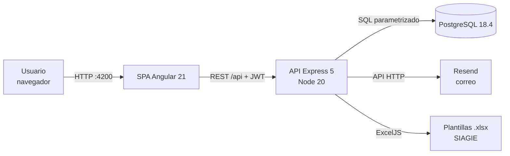
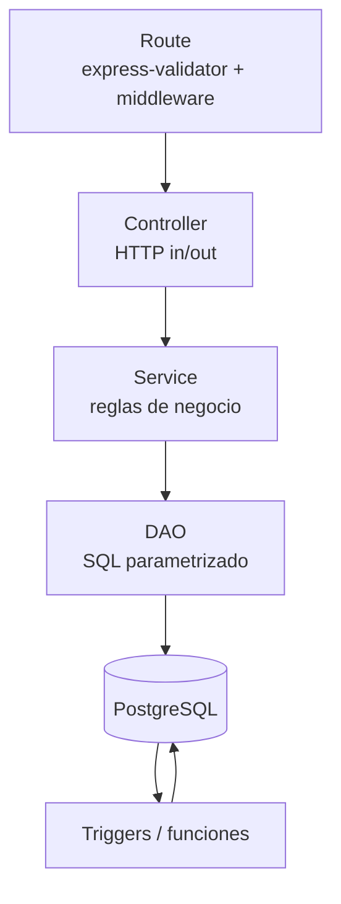
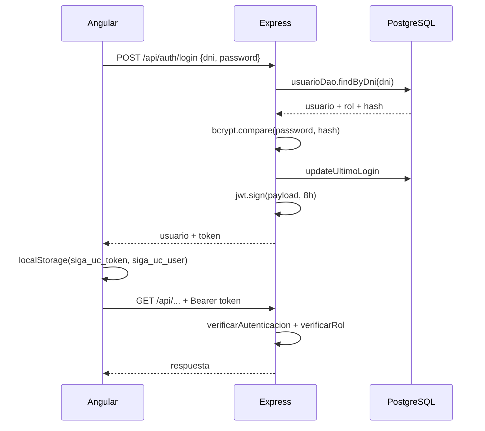

# 02 — Arquitectura y Patrones

## 1. Vista general

SIGA-UC es una aplicación web **full-stack desacoplada**:



| Capa | Tecnología | Responsabilidad |
|---|---|---|
| Presentación | Angular 21 standalone + signals + Bootstrap 5 + FontAwesome | Rutas por rol, estado reactivo, formularios, modales, impresión |
| API | Express 5 (CommonJS) | Validación, autenticación, autorización, orquestación |
| Negocio | Services | Reglas, validaciones y coordinación de DAOs |
| Datos | DAOs + `pg` | SQL crudo parametrizado, transacciones |
| Persistencia | PostgreSQL 18.4 | Restricciones, unicidad, triggers y funciones |
| Correo | Resend | Notificaciones y recuperación de contraseña |
| Archivos | Multer + ExcelJS | Plantilla SIAGIE y archivo generado |

## 2. Backend: MVC + DAO



### 2.1 Responsabilidades por capa

| Capa | Qué hace | Qué NO hace |
|---|---|---|
| `routes/` | Define método, ruta, validadores y roles; monta el router | No accede a BD |
| `controllers/` | Lee `req`, ejecuta `validationResult`, llama al service y responde con `utils/response` | No contiene SQL ni reglas complejas |
| `services/` | Valida reglas, lanza errores con `statusCode`, compone DAOs | No conoce `req/res` |
| `dao/` | Ejecuta SQL con `$1, $2...`, abre transacciones con `getClient()` | No decide permisos HTTP |
| `middlewares/` | Verifica JWT y rol | No valida datos de negocio |
| `utils/response.js` | Envoltorio uniforme de respuesta | — |

### 2.2 Flujo exacto de una petición

1. Angular adjunta `Authorization: Bearer <token>` mediante `auth.interceptor.ts`.
2. Express aplica `helmet`, CORS, `express.json` (límite 10 MB) y `morgan` en desarrollo.
3. El router del módulo aplica `verificarAutenticacion` (y `verificarRol` si corresponde).
4. `express-validator` valida campos en rutas críticas.
5. El controlador verifica `validationResult` y llama al servicio.
6. El servicio valida reglas y llama a uno o más DAOs.
7. El DAO ejecuta SQL parametrizado; si hay varias escrituras, usa transacción.
8. PostgreSQL aplica restricciones, triggers y funciones.
9. El controlador responde `{ success, message, data, timestamp }`.
10. Angular actualiza señales y renderiza.

### 2.3 Contrato de respuesta

```json
{
  "success": true,
  "message": "Operación exitosa",
  "data": {},
  "timestamp": "2026-11-19T00:00:00.000Z"
}
```

Errores:

```json
{
  "success": false,
  "message": "Descripción",
  "errors": null,
  "timestamp": "..."
}
```

Códigos usados: `200`, `201`, `400` validación/regla, `401` token, `403` rol/estado,
`404` no encontrado, `409` conflicto, `500` error interno.

### 2.4 Autenticación y autorización



Payload JWT:

```json
{
  "id_usuario": 1,
  "dni": "74829102",
  "nombre_completo": "Yarol Bello Coquil",
  "correo": "ybello@unioncientifica.edu.pe",
  "id_rol": 1,
  "rol": "ADMIN",
  "iat": 0,
  "exp": 0
}
```

Notas:
- La expiración es configurable (`JWT_EXPIRES_IN`, por defecto `8h`).
- El backend no guarda sesiones: el logout es del lado del cliente.
- El rol se toma del token; no se revalida el estado del usuario en cada petición.
- `verificarRol(...roles)` compara el string exacto del rol.

### 2.5 Configuración y arranque

`app.js`:

1. `dotenv.config()` antes de todo.
2. `env.js` valida variables obligatorias y aborta si faltan (`DB_*`, `JWT_SECRET`); lee
   `ANIO_LECTIVO` con fallback al año calendario.
3. Crea pool PostgreSQL (`max: 20`, timeout de conexión 5 s).
4. Registra 14 routers.
5. Define `GET /`, `GET /api/health` y `GET /api/configuracion`.
6. Define 404 global y manejador de errores.
7. `testConnection()` informa si la BD responde.
8. Escucha en `0.0.0.0:PORT` (por defecto 3000).
9. Verifica el correo en segundo plano; un fallo no impide arrancar.

### 2.6 Transacciones

Se usan transacciones explícitas en:

| Proceso | DAO | Operaciones |
|---|---|---|
| Matrícula | `alumnoDao.crear` | apoderado + usuario + alumno + expediente + QR |
| Personal | `personalDao.crear` | usuario + personal + QR |
| Actualización/cese | `personalDao` | usuario + personal |
| Asistencia masiva | `asistenciaDao.registrarMasivo` | N upserts |
| Calificaciones masivas | `calificacionDao.registrarMasivo` | N upserts |
| Pago | `tesoreriaDao.registrarPago` | pago + boleta + pre-ticket/pensión/matrícula |
| Pensión mensual | `tesoreriaDao.generarPensionesMensuales` | inserción masiva |
| Caja | `cajaDao.aperturar` / `cerrar` | apertura/movimiento/estado o cierre/estado |
| Tutor | `cargaCurricularDao.asignarTutor` | borra anterior + inserta nuevo |

Patrón: `BEGIN` → operaciones con `client.query` → `COMMIT`; ante error `ROLLBACK`;
`finally client.release()`.

## 3. Frontend: SPA Angular

### 3.1 Configuración

`app.config.ts`:

```ts
providers: [
  provideZoneChangeDetection({ eventCoalescing: true }),
  provideRouter(routes),
  provideHttpClient(withInterceptors([authInterceptor])),
]
```

`main.ts` importa `zone.js` en la primera línea (requisito histórico del proyecto).

### 3.2 Enrutamiento

- Lazy loading con `loadComponent`.
- Rutas raíz por rol: `/admin`, `/docente`, `/estudiante`, `/secretaria`.
- `authGuard` verifica token y expiración local (decodifica `exp`).
- `roleGuard(['ROL'])` verifica `usuario.rol`; si falla, redirige al dashboard del rol.
- `reset-password` está antes de `**` para conservar el query param `token`.
- `**` redirige a `/login`.

### 3.3 Estado

- **Signals** para todo estado reactivo (`signal`, `computed`, `update`, `set`).
- `inject()` en lugar de constructores.
- `AuthService` mantiene `usuario` como signal de solo lectura.
- `NotificacionService` mantiene `noLeidas` como signal y lo actualiza con `tap`.
- Componentes de feature usan `HttpClient` directamente; no hay servicios por módulo.
- El header refresca el contador de no leídas cada 30 s.

### 3.4 Patrones de UI

| Patrón | Implementación |
|---|---|
| Modales | `@if (senal())` + `.modal-overlay` + `stopPropagation()` |
| Loading | señal `cargando`; se apaga primero en `error:` |
| Confirmaciones | `confirm()`/`alert()` nativos en la mayoría de acciones |
| Tablas | Bootstrap + clases por estado (`pagado`, `pendiente`, `activo`, etc.) |
| Columna de acciones | `position: sticky; right: 0` |
| Números de PostgreSQL | `Number(x) \|\| 0` antes de operar |
| Wrappers | Componente standalone de ~10 líneas que renderiza otro componente |
| Impresión | `window.print()` para libretas y carné |

### 3.5 Wrappers (reutilización entre roles)

| Wrapper | Renderiza | Rol que lo usa |
|---|---|---|
| `AdminTesoreriaComponent` | `SecretariaTesoreriaComponent` | ADMIN |
| `AdminCajaComponent` | `SecretariaCajaComponent` | ADMIN |
| `SecretariaPadronComponent` | `AdminAlumnosComponent` | SECRETARIA |
| `SecretariaAsistenciaQrComponent` | `AdminAsistenciaQrComponent` | SECRETARIA |

Esto evita duplicar lógica, pero implica que los permisos efectivos dependen del backend.

## 4. Decisiones de arquitectura (ADR resumidos)

| Decisión | Motivo | Consecuencia |
|---|---|---|
| SQL crudo parametrizado en DAOs | Control total y aprendizaje del curso | Más código repetitivo; riesgo de inconsistencias |
| Sin ORM | Evitar abstracción y dependencias | Consultas explícitas y optimizables |
| Sin Docker | Entorno local Windows sencillo | Despliegue manual |
| Sin tests automatizados | Tiempo del proyecto | Regresiones detectadas manualmente |
| JWT stateless | Simplicidad y escalabilidad | No hay revocación inmediata |
| Triggers en BD | Garantizar efectos aunque falle la app | Lógica duplicada con servicios |
| Signals en Angular | Reactividad simple y moderna | Requiere disciplina de estado |
| Wrappers por rol | DRY | Permisos de UI no equivalen a permisos de API |
| Correo con Resend | Funciona en Render sin SMTP saliente | `.env.example` quedó desactualizado |

## 5. Estructura de carpetas

```text
siga-uc/
├── database/                 # Esquema, seeds y backup
├── docs/                     # Documentación operativa previa
├── documentacion/            # Esta documentación detallada
├── AGENTS.md                 # Resumen operativo para asistentes
├── siga-uc-backend/
│   ├── uploads/              # temporales SIAGIE y salidas
│   └── src/
│       ├── app.js
│       ├── config/           # env.js, academico.js, database.js
│       ├── middlewares/      # authMiddleware.js
│       ├── routes/           # 14 routers
│       ├── controllers/      # 14 controladores
│       ├── services/         # 17 servicios
│       ├── dao/              # 15 DAOs
│       └── utils/            # response.js
└── siga-uc-frontend/
    └── src/app/
        ├── core/             # guards, interceptor, models, services
        ├── shared/components/# header + 4 sidebars
        ├── features/         # admin, docente, estudiante, secretaria, auth
        ├── app.routes.ts
        └── app.config.ts
```

## 6. Deuda técnica visible

- Lógica de negocio duplicada entre servicios/DAOs y triggers.
- Año 2026 y IDs de conceptos codificados en frontend/backend.
- GET amplios sin verificación de pertenencia.
- Ausencia de validación con `express-validator` en la mayoría de endpoints.
- `bitacora_auditoria` solo se alimenta automáticamente desde calificaciones.
- Frontend sin servicios de feature ni manejo centralizado de errores.
- `environment.prod.ts` apunta a una URL de Render; debe parametrizarse por entorno.
