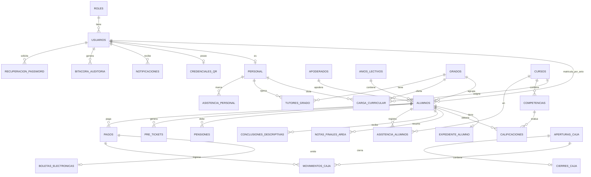

# 04 — Base de Datos

**Motor:** PostgreSQL 18.4 · **Base:** `siga_uc` · **Extensiones:** `pgcrypto`, `unaccent`,
`uuid-ossp` · **Zona horaria:** `America/Lima`

Fuente: `database/siga_uc.sql` (esquema) y `database/siga_uc_completo.sql` (esquema + datos).
El backup `siga_uc_backup.sql` no se versiona.

---

## 1. Panorama

| Módulo | Tablas | Total |
|---|---|---|
| Seguridad | `roles`, `usuarios`, `recuperacion_password`, `personal`, `asistencia_personal`, `bitacora_auditoria`, `notificaciones`, `credenciales_qr` | 8 |
| Multi-año | `anios_lectivos` | 1 |
| Promociones | `promociones`, `politicas_promocion` | 2 |
| Configuración | `configuracion_institucional`, `configuracion_anio` | 2 |
| Curricular | `grados`, `cursos`, `competencias`, `carga_curricular`, `tutores_grado`, `horarios`, `periodos_clase`, `escala_calificacion`, `areas_academicas` | 9 |
| Alumnos | `apoderados`, `alumnos`, `expediente_alumno` | 3 |
| Asistencia | `asistencia_alumnos`, `resumen_asistencia_curso` | 2 |
| Calificaciones | `calificaciones`, `notas_finales_area`, `conclusiones_descriptivas`, `actas_bimestrales`, `libretas` | 5 |
| Tesorería | `conceptos_pago`, `tipos_beca`, `becas`, `aplicaciones_beca`, `pensiones`, `pre_tickets`, `pagos`, `boletas_electronicas` | 8 |
| Caja | `cajas`, `aperturas_caja`, `movimientos_caja`, `cierres_caja` | 4 |
| SIAGIE | `exportaciones_siagie`, `estado_carga_docentes` | 2 |
| Reportes | `cuadro_merito`, `alumnos_riesgo` | 2 |
| **Total** | | **48** |

> **Tablas de solo estructura / históricas:** `resumen_asistencia_curso`, `libretas`,
> `cuadro_merito`, `alumnos_riesgo` y `estado_carga_docentes` existen en el esquema, pero el
> código actual calcula esa información al vuelo y **no la persiste**. No eliminarlas sin
> revisar el esquema y futuras funcionalidades.

---

## 2. Modelo relacional por módulo



---

## 3. Catálogo de tablas

### 3.1 Seguridad

#### `roles`
| Columna | Tipo | Restricción |
|---|---|---|
| `id_rol` | integer | PK |
| `nombre_rol` | varchar(50) | UNIQUE, CHECK `ADMIN/DOCENTE/SECRETARIA/ESTUDIANTE` |
| `descripcion` | varchar(200) | — |
| `fecha_creacion` | timestamp | default `now()` |

#### `usuarios`
| Columna | Tipo | Restricción |
|---|---|---|
| `id_usuario` | integer | PK |
| `dni` | char(8) | UNIQUE, CHECK 8 dígitos |
| `nombres`, `apellidos` | varchar(100) | NOT NULL |
| `correo_institucional` | varchar(150) | UNIQUE, NOT NULL (decorativo) |
| `correo_personal` | varchar(150) | NULL (real para envíos) |
| `password_hash` | varchar(255) | NOT NULL (bcrypt) |
| `telefono` | varchar(15) | — |
| `id_rol` | integer | FK → `roles(id_rol)` ON UPDATE CASCADE |
| `estado` | varchar(20) | CHECK `ACTIVO/INACTIVO/CESADO`, default `ACTIVO` |
| `requiere_cambio_password` | boolean | default `false` |
| `ultimo_login` | timestamp | — |
| `fecha_creacion` | timestamp | default `now()` |
| `fecha_actualizacion` | timestamp | actualizado por trigger |

#### `personal`
| Columna | Tipo | Restricción |
|---|---|---|
| `id_personal` | integer | PK |
| `id_usuario` | integer | UNIQUE, FK → `usuarios` ON DELETE CASCADE |
| `especialidad` | varchar(150) | — |
| `cargo` | varchar(100) | — |
| `fecha_ingreso` | date | — |
| `fecha_cese` | date | — |
| `motivo_cese` | varchar(200) | — |

#### `credenciales_qr`
| Columna | Tipo | Restricción |
|---|---|---|
| `id_credencial` | integer | PK |
| `id_usuario` | integer | UNIQUE, FK → `usuarios` ON DELETE CASCADE |
| `codigo_qr` | varchar(255) | UNIQUE |
| `tipo` | varchar(20) | CHECK `ESTUDIANTE/DOCENTE/ADMIN/SECRETARIA` |
| `fecha_emision` | timestamp | default `now()` |
| `activo` | boolean | default `true` |

#### `recuperacion_password`
| Columna | Tipo | Restricción |
|---|---|---|
| `id_recuperacion` | integer | PK |
| `id_usuario` | integer | FK → `usuarios` ON DELETE CASCADE |
| `token` | varchar(255) | UNIQUE |
| `fecha_solicitud` | timestamp | default `now()` |
| `fecha_expiracion` | timestamp | NOT NULL (NOW() + 2 h) |
| `usado` | boolean | default `false` |

#### `bitacora_auditoria`
| Columna | Tipo | Restricción |
|---|---|---|
| `id_bitacora` | bigint | PK |
| `id_usuario` | integer | FK → `usuarios` ON DELETE SET NULL |
| `fecha_hora` | timestamp | default `now()` |
| `modulo_afectado` | varchar(100) | NOT NULL |
| `accion` | varchar(50) | NOT NULL (`LOGIN`, `CREAR`, `MODIFICAR`, `ANULAR`, …) |
| `descripcion` | text | — |
| `valor_anterior` | jsonb | — |
| `valor_nuevo` | jsonb | — |
| `motivo` | varchar(500) | H74; motivo declarado en cambios de configuración |
| `ip_origen` | varchar(45) | — |

#### `notificaciones`
| Columna | Tipo | Restricción |
|---|---|---|
| `id_notificacion` | integer | PK |
| `id_usuario_destino` | integer | FK → `usuarios` ON DELETE CASCADE |
| `id_usuario_remitente` | integer | FK → `usuarios` ON DELETE SET NULL |
| `asunto` | varchar(200) | NOT NULL |
| `cuerpo` | text | NOT NULL |
| `leido` | boolean | default `false` |
| `fecha_envio` | timestamp | default `now()` |

#### `asistencia_personal`
| Columna | Tipo | Restricción |
|---|---|---|
| `id_asistencia_personal` | integer | PK |
| `id_personal` | integer | FK → `personal` ON DELETE CASCADE |
| `fecha` | date | NOT NULL |
| `hora_ingreso`, `hora_salida` | time | — |
| `estado` | varchar(20) | CHECK `Puntual/Tardanza/Falta` o NULL |
| `observacion` | varchar(200) | — |
| — | — | UNIQUE (`id_personal`, `fecha`) |

### 3.2 Curricular

#### `anios_lectivos` (H49/6.1)
`anio` PK CHECK 2000..2100 · `estado` CHECK `PLANIFICADO/ACTIVO/CERRADO` · `fecha_inicio`,
`fecha_fin` · `creado_por`, `fecha_creacion`, `cerrado_por`, `fecha_cierre`, `observacion`.
Índice único parcial `uq_anio_activo` sobre `estado` cuando es `ACTIVO`: solo puede existir
un año activo. `ANIO_LECTIVO` queda como bootstrap/fallback.

#### `grados`
`id_grado` PK · `nombre_grado` varchar(50) · `nivel` varchar(20) · `seccion` varchar(10) ·
`anio_lectivo` integer · `orden` integer NOT NULL CHECK > 0 · UNIQUE
(`nombre_grado`, `seccion`, `anio_lectivo`) · UNIQUE
(`anio_lectivo`, `nivel`, `seccion`, `orden`) (`uq_grado_anio_nivel_seccion_orden`).

#### `cursos`
`id_curso` PK · `nombre_curso` varchar(100) UNIQUE · `area_academica` varchar(50) ·
`horas_semanales` integer.

#### `competencias`
`id_competencia` PK · `id_curso` FK → `cursos` ON DELETE CASCADE · `nombre_competencia`
varchar(250) · `orden` integer.

#### `carga_curricular`
`id_carga` PK · `id_grado` FK → `grados` ON DELETE CASCADE · `id_curso` FK → `cursos` ON
DELETE CASCADE · `id_personal` FK → `personal` ON DELETE CASCADE · `anio_lectivo` integer ·
`horas_asignadas` integer · UNIQUE (`id_grado`, `id_curso`, `anio_lectivo`).

#### `tutores_grado`
`id_tutor` PK · `id_grado` FK → `grados` ON DELETE CASCADE · `id_personal` FK → `personal` ON
DELETE CASCADE · `anio_lectivo` integer · UNIQUE (`id_grado`, `anio_lectivo`).

#### `periodos_clase`
`id_periodo` PK · `anio_lectivo` integer · `nombre` varchar(30) · `orden` integer · `hora_inicio`,
`hora_fin` · `tipo` CHECK `CLASE/RECREO/ALMUERZO` · `activo` boolean · UNIQUE
(`anio_lectivo`, `orden`) · trigger que impide solapes de tiempo dentro del mismo año.

#### `horarios`
`id_horario` PK · `id_carga` FK → `carga_curricular` ON DELETE RESTRICT · `id_grado` FK →
`grados` RESTRICT · `id_curso` FK → `cursos` RESTRICT · `id_personal` FK → `personal`
RESTRICT · `anio_lectivo` · `dia_semana` CHECK `Lunes..Viernes` · `id_periodo` FK →
`periodos_clase` RESTRICT · `aula` nullable · `estado` CHECK `BORRADOR/PUBLICADO` ·
`creado_por`, `actualizado_por`, `creado_en`, `actualizado_en` · UNIQUE
(`anio_lectivo`, `id_grado`, `dia_semana`, `id_periodo`) · UNIQUE
(`anio_lectivo`, `id_personal`, `dia_semana`, `id_periodo`) · índice único parcial de
`aula` (sin distinguir mayúsculas/espacios) · trigger que valida año/grado/curso/docente
contra `id_carga` y que el período sea `CLASE`.

#### `escala_calificacion`
`id_escala` PK · `codigo` varchar(5) UNIQUE CHECK `AD/A/B/C` · `descripcion` · `orden`.

### 3.3 Alumnos

#### `apoderados`
`id_apoderado` PK · `nombres`, `apellidos` NOT NULL · `dni` char(8) UNIQUE (nullable) ·
`telefono` · `correo`.

#### `alumnos`
| Columna | Tipo | Restricción |
|---|---|---|
| `id_alumno` | integer | PK |
| `id_usuario` | integer | FK → `usuarios` ON DELETE CASCADE · UNIQUE (`id_usuario`, `anio_lectivo`) |
| `dni` | char(8) | CHECK 8 dígitos · UNIQUE (`dni`, `anio_lectivo`) |
| `nombres`, `apellidos` | varchar(100) | NOT NULL |
| `fecha_nacimiento` | date | NOT NULL |
| `id_apoderado` | integer | FK → `apoderados` ON DELETE SET NULL |
| `id_grado` | integer | FK → `grados` ON DELETE SET NULL |
| `condicion` | varchar(20) | CHECK `Regular/Traslado/Retirado` |
| `colegio_procedencia` | varchar(200) | — |
| `estado_matricula` | varchar(30) | CHECK `Matriculado/PendientePago/Retirado` |
| `fecha_retiro` | date | — |
| `motivo_retiro`, `colegio_destino` | varchar(200) | — |
| `resolucion_directoral` | varchar(100) | — |
| `codigo_estudiante` | varchar(20) | UNIQUE (`codigo_estudiante`, `anio_lectivo`); puede ser NULL |
| `anio_lectivo` | integer | NOT NULL |
| `fecha_creacion` | timestamp | default `now()` |

Una fila de `alumnos` es una **matrícula anual**, no la identidad permanente. `usuarios`
sigue siendo único por DNI y `credenciales_qr` sigue siendo una por usuario. El mismo
`id_usuario`, DNI o código puede repetirse en años distintos, pero no dentro del mismo año.
La migración H49 (`migracion_h49_multianio_base.sql`) reemplaza los UNIQUE globales por
`uq_alumno_dni_anio`, `uq_alumno_usuario_anio` y `uq_alumno_codigo_anio`.

#### `expediente_alumno`
`id_expediente` PK · `id_alumno` UNIQUE FK → `alumnos` ON DELETE CASCADE ·
`nivel_logro_actual` varchar(5) · `asistencia_acumulada` numeric(5,2) · `congelado` boolean
default `false`.

### 3.4 Asistencia

#### `asistencia_alumnos`
`id_asistencia` PK · `id_alumno` FK → `alumnos` ON DELETE CASCADE · `id_curso` FK → `cursos`
ON DELETE CASCADE · `id_personal` FK → `personal` ON DELETE SET NULL · `id_grado` FK →
`grados` ON DELETE CASCADE · `fecha` date · `dia_semana` varchar(15) · `estado` char(1) CHECK
`P/T/F` · `observacion` varchar(250) · `justificada` boolean default `false` ·
`motivo_justificacion` varchar(250) · `fecha_registro` timestamp · UNIQUE (`id_alumno`,
`id_curso`, `fecha`). **No tiene columna `anio_lectivo`**: el año se deriva de `fecha` con
`EXTRACT(YEAR FROM fecha)` y la matrícula anual ya separa `id_alumno`. Se recomiendan índices
`(id_alumno, fecha)` e `(id_grado, fecha)`, no una columna nueva en 6.1.

#### `resumen_asistencia_curso` (estructura, no persistida por el código)
`id_resumen` PK · `id_alumno` FK · `id_curso` FK · `porcentaje_asistencia` · `total_presente`
· `total_tardanza` · `total_falta` · UNIQUE (`id_alumno`, `id_curso`).

### 3.5 Calificaciones

#### `calificaciones`
`id_calificacion` PK · `id_alumno` FK → `alumnos` ON DELETE CASCADE · `id_curso` FK →
`cursos` ON DELETE CASCADE · `id_competencia` FK → `competencias` ON DELETE CASCADE ·
`id_personal` FK → `personal` ON DELETE SET NULL · `id_grado` FK → `grados` ON DELETE CASCADE
· `bimestre` integer CHECK 1–4 · `anio_lectivo` integer · `calificacion` varchar(5) CHECK
`AD/A/B/C` · `fecha_registro` · `fecha_modificacion` · `modificado_por` FK → `usuarios` ON
DELETE SET NULL · `justificacion_modificacion` text · UNIQUE (`id_alumno`, `id_curso`,
`id_competencia`, `bimestre`, `anio_lectivo`).

#### `notas_finales_area`
`id_nota_final` PK · `id_alumno` FK · `id_curso` FK · `bimestre` CHECK 1–4 · `anio_lectivo` ·
`nota_final` CHECK `AD/A/B/C` · `calculo_automatico` boolean default `true` · UNIQUE
(`id_alumno`, `id_curso`, `bimestre`, `anio_lectivo`).

#### `conclusiones_descriptivas`
`id_conclusion` PK · `id_alumno` FK · `id_curso` FK · `bimestre` · `anio_lectivo` ·
`descripcion` text · `id_personal` FK → `personal` ON DELETE SET NULL · UNIQUE (`id_alumno`,
`id_curso`, `bimestre`, `anio_lectivo`).

#### `actas_bimestrales`
`id_acta` PK · `periodo` varchar(30) · `anio_lectivo` · `bimestre` NOT NULL CHECK 1-4 ·
`id_grado` FK → `grados` ON DELETE CASCADE (nullable; `NULL` = acta global) · `estado`
CHECK `ABIERTO/CERRADO` default `ABIERTO` · `fecha_cierre` · `cerrado_por` FK → `usuarios`
ON DELETE SET NULL · `reabierto_por` FK → `usuarios` ON DELETE SET NULL ·
`fecha_reapertura` · `motivo_reapertura` varchar(250) · `hash_integridad` varchar(255).
UNIQUE `(anio_lectivo, bimestre, id_grado)` con `NULLS NOT DISTINCT`
(`uq_acta_anio_bimestre_grado`), migración `migracion_h48_actas.sql`. Un acta global
`CERRADO` bloquea las notas de todos los grados.

#### `libretas` (estructura, no persistida por el código)
`id_libreta` PK · `id_alumno` FK · `bimestre` · `anio_lectivo` · `id_tutor` FK → `personal` ON
DELETE SET NULL · `fecha_emision` · `promedio_general` varchar(5) · `asistencia_global`
numeric(5,2) · UNIQUE (`id_alumno`, `bimestre`, `anio_lectivo`).

### 3.6 Tesorería

#### `conceptos_pago`
`id_concepto` PK · `nombre` varchar(100) · `monto_base` numeric(10,2) · `tipo` CHECK
`MATRICULA/PENSION/OTROS` · `mes` integer CHECK 1–12 (nullable) · `anio_lectivo` · `nivel`,
`id_grado`, `activo`, `orden`, `vigente_desde`, `vigente_hasta` (H75). La función
`resolver_concepto_pago` aplica grado > nivel > global y la vigencia.

#### `tipos_beca` (H78)
`id_tipo_beca` PK · `codigo` UNIQUE · `nombre` · `descripcion` · `alcance` CHECK
`MATRICULA/PENSION/AMBOS` · `modalidad` CHECK `PORCENTAJE/MONTO_FIJO` · `valor_default` ·
`tope_monto` · `permite_combinacion` · `grupo_exclusividad` · `prioridad` ·
`requiere_evidencia` · `requiere_aprobacion` · `activo` · `orden` · auditoría.

#### `becas`
`id_beca` PK · `id_alumno` FK → `alumnos` ON DELETE CASCADE · `id_tipo_beca` FK →
`tipos_beca` ON DELETE RESTRICT · `tipo` (código legacy) · `porcentaje_descuento` CHECK 0–100 ·
`monto_descuento` · `fecha_inicio` · `fecha_fin` · `activo` · `alcance`, `modalidad`, `valor`,
`monto_maximo`, `estado` (`SOLICITADA/APROBADA/RECHAZADA/ANULADA`), `motivo`, `evidencia`
jsonb, `aprobado_por`, `fecha_aprobacion`, `grupo_exclusividad`, `prioridad` (H78).

#### `aplicaciones_beca` (H78)
`id_aplicacion` PK · `id_beca` FK → `becas` ON DELETE RESTRICT · `id_pension` o
`id_preticket` (exactamente uno) · `monto_aplicado` · `porcentaje_aplicado` · `creado_por` ·
`creado_en` · UNIQUE por beca/pensión y beca/pre-ticket.

#### `pensiones`
`id_pension` PK · `id_alumno` FK → `alumnos` ON DELETE CASCADE · `anio_lectivo` · `mes`
CHECK 1–12 · `monto_base` · `descuento` default 0 · `monto_final` · `estado` CHECK
`PAGADO/PENDIENTE/ANULADO/EXONERADO` default `PENDIENTE` · `id_beca` FK → `becas` ON DELETE
SET NULL · `id_concepto` (H75) · UNIQUE (`id_alumno`, `anio_lectivo`, `mes`). Las pensiones
`ANULADO` no se cobran y pueden volver a `PENDIENTE` al regenerar el cronograma (H45).
`EXONERADO` representa un cargo en 0 por beca, sin pago que lo respalde (H78).

#### `pre_tickets`
`id_preticket` PK · `id_alumno` FK → `alumnos` ON DELETE CASCADE · `id_concepto` FK →
`conceptos_pago` ON DELETE CASCADE · `monto` · `descuento` (H78) · `estado` CHECK
`PENDIENTE/PAGADO/ANULADO/EXONERADO` · `fecha_emision` · `fecha_pago` · `id_usuario_emite`
FK → `usuarios` ON DELETE SET NULL.

#### `pagos`
`id_pago` PK · `id_alumno` FK → `alumnos` ON DELETE CASCADE · `id_preticket` FK → `pre_tickets`
ON DELETE SET NULL · `id_pension` FK → `pensiones` ON DELETE SET NULL · `id_concepto` FK →
`conceptos_pago` ON DELETE CASCADE · `monto` numeric(10,2) · `forma_pago` CHECK
`Efectivo/Yape/Plin/Interbank/BCP/BBVA` · `nro_operacion` · `fecha_pago` · `id_usuario_cobrador`
FK → `usuarios` ON DELETE SET NULL · `estado` CHECK `PAGADO/ANULADO` default `PAGADO`.

#### `boletas_electronicas`
`id_boleta` PK · `id_pago` FK → `pagos` ON DELETE CASCADE · `numero_boleta` varchar(20) UNIQUE ·
`serie` varchar(10) · `numero` integer · `fecha_emision` · `monto_total` · `estado_sunat` CHECK
`ACEPTADO/PENDIENTE/RECHAZADO` (nullable) · `xml_url`, `pdf_url`, `hash_cpe`.

### 3.7 Caja

#### `cajas`
`id_caja` PK · `nombre_caja` varchar(100) · `responsable` FK → `usuarios` ON DELETE SET NULL ·
`estado` CHECK `ABIERTA/CERRADA` default `CERRADA`.

#### `aperturas_caja`
`id_apertura` PK · `id_caja` FK → `cajas` ON DELETE CASCADE · `monto_inicial` numeric(10,2) ·
`id_usuario_apertura` FK → `usuarios` ON DELETE SET NULL · `fecha_apertura` default `now()` ·
`observaciones` text.

#### `movimientos_caja`
`id_movimiento` PK · `id_apertura` FK → `aperturas_caja` ON DELETE CASCADE · `id_pago` FK →
`pagos` ON DELETE SET NULL · `tipo` CHECK `INGRESO/EGRESO/APERTURA` · `concepto` varchar(250) ·
`monto` · `medio_pago` · `nro_comprobante` · `fecha_hora` · `id_usuario` FK → `usuarios` ON
DELETE SET NULL.

#### `cierres_caja`
`id_cierre` PK · `id_apertura` FK → `aperturas_caja` ON DELETE CASCADE · `monto_apertura` ·
`total_ingresos_efectivo` · `total_ingresos_digital` · `total_egresos` · `efectivo_esperado` ·
`efectivo_fisico` · `diferencia` · `total_general` · `id_usuario_cierre` FK → `usuarios` ON
DELETE SET NULL · `fecha_cierre` · `estado` CHECK `CUADRADO/SOBRANTE/FALTANTE`.

### 3.8 SIAGIE y reportes

#### `exportaciones_siagie`
`id_exportacion` PK · `id_grado` FK → `grados` ON DELETE CASCADE · `bimestre` · `anio_lectivo` ·
`nombre_archivo` · `fecha_generacion` · `id_usuario` FK → `usuarios` ON DELETE SET NULL ·
`estado`.

#### `estado_carga_docentes` (estructura, calculada al vuelo)
`id_estado_carga` PK · `id_personal` FK · `id_curso` FK · `id_grado` FK · `bimestre` ·
`total_alumnos` · `alumnos_calificados` · `porcentaje` · `estado` CHECK
`COMPLETO/PENDIENTE`.

#### `cuadro_merito` (estructura, calculada al vuelo)
`id_cuadro` PK · `id_alumno` FK · `id_grado` FK · `bimestre` · `anio_lectivo` · `puesto` ·
`predominancia_logro` · `merito` · UNIQUE (`id_alumno`, `bimestre`, `anio_lectivo`).

#### `alumnos_riesgo` (estructura, calculada al vuelo)
`id_riesgo` PK · `id_alumno` FK · `id_grado` FK · `bimestre` · `cursos_logro_c` text · `id_tutor`
FK → `personal` ON DELETE SET NULL · `accion_correctiva` text · UNIQUE (`id_alumno`,
`bimestre`).

### 3.9 Promociones (H73/6.3)

#### `politicas_promocion`
`id_politica` PK serial · `anio_origen` · `anio_destino` nullable · `nombre` · `activo` ·
`requiere_actas_cerradas` · `requiere_notas_finales` · `umbral_asistencia` (0–100 o NULL) ·
`criterio_academico` jsonb descriptivo (**no** codifica la norma nacional) ·
`permite_override` (default `FALSE`) · `creado_por` FK → `usuarios` ON DELETE SET NULL ·
`fecha_creacion`. CHECK `anio_destino > anio_origen` cuando no es NULL.
UNIQUE parcial `(anio_origen, anio_destino, nombre)` con destino y `(anio_origen, nombre)`
sin destino.

`criterio_academico` admite `modo_repitencia` (`DESACTIVADA`/`UMBRAL`), `notas_bimestre`
(1–4), `bimestres_requeridos`, `min_cursos_desaprobados`, `notas_desaprobadas`,
`transiciones` y `observacion`. El sistema solo aplica lo que el ADMIN configure.

#### `promociones`
`id_promocion` PK bigserial · `id_alumno_origen` FK → `alumnos` RESTRICT ·
`id_alumno_destino` FK → `alumnos` SET NULL · `anio_origen` · `anio_destino` nullable ·
`id_grado_origen` FK → `grados` RESTRICT · `id_grado_destino` FK → `grados` RESTRICT ·
`estado` (`PREVISUALIZADA/CONFIRMADA/ANULADA/ERROR`) · `resultado`
(`PROMOVIDO/REPITENTE/EGRESADO/RETIRADO/PENDIENTE`) · `es_override` · `motivo` ·
`observacion` · `id_usuario` FK → `usuarios` SET NULL · `fecha_creacion` ·
`fecha_confirmacion` · `id_promocion_reversa` FK a sí misma SET NULL · `metadata` jsonb.

Índices parciales: una sola promoción `CONFIRMADA` por `id_alumno_origen` y una sola
matrícula destino por promoción confirmada. No usa `ON DELETE CASCADE`; no agrega
`TRASLADADO` (traslado = `RETIRADO` + condición `Traslado`).

### 3.10 Configuración (H74/Fase 1)

#### `configuracion_institucional` (una sola fila)
`id_configuracion` smallint PK CHECK = 1 · `nombre_institucion` · `nombre_corto` · `ruc`
(11 dígitos o NULL) · `direccion`, `distrito`, `provincia`, `departamento`, `pais` ·
`telefono`, `correo_contacto`, `sitio_web`, `logo_url` · `moneda` char(3) default `PEN` ·
`simbolo_moneda` default `S/` · `zona_horaria` default `America/Lima` · `locale` default
`es-PE` · `nombre_remitente` · `texto_boleta`, `texto_libreta`, `texto_acta`, `texto_pie` ·
`serie_boleta` default `B001` · `numero_boleta_inicial` default 4820 · `actualizado_por` FK
usuarios SET NULL · `actualizado_en` · `setup_completado` boolean default false ·
`setup_completado_en` · `setup_completado_por` FK usuarios SET NULL (H79).

> La migración H74 inserta la fila inicial con los datos institucionales actuales. H79 marca
> `setup_completado` cuando ya existe un ADMIN o cuando termina el asistente `/setup`. El
> ADMIN puede editar la institución desde `/admin/configuracion`; `GET /api/configuracion`
> solo expone nombre, nombre corto, logo, moneda, símbolo, zona horaria y locale.

#### `configuracion_anio` (una fila por año)
`anio` PK/FK `anios_lectivos` ON DELETE CASCADE · `dias_clase` varchar(15)[] default
Lunes–Viernes · `hora_inicio_jornada`, `hora_fin_jornada` · `duracion_min_bloque` default 45
· `max_bloques_curso_dia` default 2 · `horas_default_carga` default 2 ·
`politica_inicio_pension` (`MES_MATRICULA`/`PRIMER_MES_CONFIGURADO`/`MES_FIJO`) ·
`mes_inicio_pension` · `version` · `actualizado_por`, `actualizado_en`.

> H74 crea una fila por año existente y toma la jornada de `periodos_clase` cuando H47 está
> aplicada. El trigger `trg_anio_configuracion` crea la fila al insertar un año nuevo. La
> jornada, los días y los límites se editan desde `/admin/configuracion/horarios` (H77).

---

## 4. Restricciones de negocio en BD (CHECK)

| Tabla | Columna | Valores |
|---|---|---|
| `roles` | `nombre_rol` | ADMIN, DOCENTE, SECRETARIA, ESTUDIANTE |
| `usuarios` | `estado` | ACTIVO, INACTIVO, CESADO |
| `usuarios`, `alumnos` | `dni` | `^[0-9]{8}$` |
| `alumnos` | `condicion` | Regular, Traslado, Retirado |
| `alumnos` | `estado_matricula` | Matriculado, PendientePago, Retirado |
| `asistencia_alumnos` | `estado` | P, T, F |
| `asistencia_personal` | `estado` | Puntual, Tardanza, Falta (o NULL) |
| `calificaciones` | `calificacion` | AD, A, B, C |
| `calificaciones`, `notas_finales_area`, `conclusiones_descriptivas` | `bimestre` | 1–4 |
| `escala_calificacion` | `codigo` | AD, A, B, C |
| `conceptos_pago` | `tipo` | MATRICULA, PENSION, OTROS |
| `conceptos_pago` | `mes` | 1–12 o NULL |
| `pensiones` | `mes` | 1–12 |
| `pensiones` | `estado` | PAGADO, PENDIENTE, ANULADO |
| `pre_tickets` | `estado` | PENDIENTE, PAGADO, ANULADO |
| `pagos` | `forma_pago` | Efectivo, Yape, Plin, Interbank, BCP, BBVA |
| `pagos` | `estado` | PAGADO, ANULADO |
| `boletas_electronicas` | `estado_sunat` | ACEPTADO, PENDIENTE, RECHAZADO |
| `cajas` | `estado` | ABIERTA, CERRADA |
| `movimientos_caja` | `tipo` | INGRESO, EGRESO, APERTURA |
| `cierres_caja` | `estado` | CUADRADO, SOBRANTE, FALTANTE |
| `horarios` | `dia_semana` | Lunes … Domingo (H77) |
| `periodos_clase` | `tipo` | CLASE, RECREO, ALMUERZO |
| `periodos_clase` | `hora_fin` | > `hora_inicio` |
| `horarios` | `estado` | BORRADOR, PUBLICADO |
| `actas_bimestrales` | `estado` | ABIERTO, CERRADO |
| `becas` | `estado` | SOLICITADA, APROBADA, RECHAZADA, ANULADA |
| `becas` | `alcance` / `modalidad` | MATRICULA/PENSION/AMBOS · PORCENTAJE/MONTO_FIJO |
| `becas` | `porcentaje_descuento` / `valor` | 0–100 |
| `credenciales_qr` | `tipo` | ESTUDIANTE, DOCENTE, ADMIN, SECRETARIA |

---

## 5. Índices

Además de los índices automáticos de PK/UNIQUE, el esquema define **26 índices btree**:

| Tabla | Índices |
|---|---|
| `actas_bimestrales` | UNIQUE `(anio_lectivo, bimestre, id_grado)` `NULLS NOT DISTINCT` (H48) |
| `alumnos` | `anio_lectivo`, `dni`, `estado_matricula`, `id_grado` |
| `asistencia_alumnos` | `id_alumno`, `(id_curso, fecha)`, `fecha` |
| `asistencia_personal` | `fecha` |
| `bitacora_auditoria` | `fecha_hora`, `modulo_afectado`, `id_usuario` |
| `calificaciones` | `(id_alumno, id_curso)`, `(bimestre, anio_lectivo)` |
| `carga_curricular` | `id_personal` |
| `competencias` | `id_curso` |
| `grados` | `anio_lectivo` |
| `horarios` | `(id_grado, dia_semana)` |
| `notificaciones` | `(id_usuario_destino, leido)` |
| `pagos` | `id_alumno`, `fecha_pago` |
| `personal` | `id_usuario` |
| `recuperacion_password` | `token` |
| `usuarios` | `correo_institucional`, `dni`, `id_rol` |

---

## 6. Funciones y triggers (11 base + H47/H48/H74)

### 6.1 `trg_actualizar_timestamp()`
Trigger `trg_usuarios_actualizar` **BEFORE UPDATE** en `usuarios`. Asigna
`fecha_actualizacion = NOW()`.

### 6.2 `trg_auditar_calificacion()`
Trigger `trg_calificaciones_audit` **AFTER INSERT OR UPDATE** en `calificaciones`.

- Usuario: `COALESCE(NEW.modificado_por, OLD.modificado_por)`.
- Módulo: `Evaluaciones`.
- Acción: `CREAR` en INSERT, `MODIFICAR` en UPDATE.
- Descripción: `Calificación alumno ID <id>`.
- `valor_anterior`: JSONB con la calificación anterior (solo UPDATE).
- `valor_nuevo`: JSONB con la nueva calificación.

> Es el **único trigger que alimenta la bitácora**. El login y las operaciones
> administrativas no se auditan automáticamente.

### 6.3 `trg_actualizar_preticket()`
Trigger `trg_pagos_preticket` **AFTER INSERT** en `pagos`. Si `NEW.id_preticket` no es NULL,
marca el pre-ticket como `PAGADO` y `fecha_pago = NOW()`.

### 6.4 `trg_actualizar_pension()`
Trigger `trg_pagos_pension` **AFTER INSERT** en `pagos`. Si `NEW.id_pension` no es NULL, marca
la pensión como `PAGADO`.

### 6.5 `trg_pago_a_caja()`
Trigger `trg_pagos_mov_caja` **AFTER INSERT** en `pagos`. Busca la **última apertura**
(`ORDER BY fecha_apertura DESC LIMIT 1`) y registra un `INGRESO` en `movimientos_caja` con el
monto, forma de pago y cobrador.

> No verifica que la apertura esté abierta (sin cierre). Ver hallazgos.

### 6.6 `calcular_nota_final_area(p_id_alumno, p_id_curso, p_bimestre, p_anio)`
Función PL/pgSQL que cuenta `AD/A/B/C` y devuelve:

- `AD` si hay ≥2 AD.
- `A` si hay ≥2 A.
- `B` si hay ≥2 B.
- En cualquier otro caso, `C`.

> **Divergencia:** el DAO `calificacionDao.calcularNotaFinal` agrega un desempate por la mejor
> nota cuando ninguna alcanza 2. La función SQL no. El backend usa el DAO; la función queda
> como respaldo/legado. Ver hallazgos.

### 6.7 Duplicación app ↔ triggers
`tesoreriaDao.registrarPago` actualiza manualmente pre-ticket, pensión y matrícula, y además
los triggers 6.3/6.4/6.5 hacen lo mismo. Las operaciones son idempotentes, pero hay
duplicación de lógica. El movimiento de caja solo lo crea el trigger.

### 6.8 `trg_configuracion_anio_crear()` (H74)
Trigger **AFTER INSERT** en `anios_lectivos`. Inserta una fila default en
`configuracion_anio` para el año nuevo (`dias_clase` Lunes–Viernes, duración 45, máximos 2)
con `ON CONFLICT DO NOTHING`. Así el rollover y cualquier alta de año no quedan sin
configuración. H77 completa la jornada (`07:30`/`14:30`) y amplía los días válidos a
lunes–domingo.

---

## 7. Datos de ejemplo (`siga_uc_completo.sql`)

| Entidad | Registros | Detalle |
|---|---|---|
| Roles | 4 | ADMIN(1), DOCENTE(2), SECRETARIA(3), ESTUDIANTE(4) |
| Usuarios | 29 | 1 admin, 1 secretaria, 6 docentes (1 cesado), 21 estudiantes |
| Alumnos | 21 | 20 activos + 1 retirado; 3 en `PendientePago` |
| Personal | 7 | Docentes + secretaría; 1 cesado |
| Grados | 5 | 1.º a 5.º de secundaria, sección única, 2026 |
| Cursos | 11 | Matemáticas (5), Lenguaje (2), Ciencias Naturales (2), Sociales (2) |
| Competencias | 29 | 2–4 por curso |
| Carga curricular | 54 | 11 cursos × 5 grados aprox. |
| Tutores | 5 | Uno por grado |
| Horarios | 13 | Solo 2.º de secundaria, Lunes–Miércoles en el seed |
| Conceptos de pago | 11 | Matrícula + pensiones marzo–diciembre |
| Pensiones | 180 | 18 alumnos × 10 meses aprox. |
| Pagos | 10 | Con boletas `B001-004821..4830` |
| Asistencias de alumnos | 14 | P/T/F de ejemplo |
| Asistencias de personal | 2 | Puntual/Tardanza |
| Notificaciones | 8 | Buzón de ejemplo |
| Credenciales QR | 29 | Una por usuario |
| Actas | 2 | 1.º y 2.º bimestre |
| Exportaciones SIAGIE | 4 | Historial de ejemplo |
| Bitácora | 8 | Registros manuales de ejemplo |

> Los datos semilla son **ficticios**. No usarlos en producción.

---

## 8. Consultas operativas útiles

```sql
-- Verificar tablas
SELECT table_name FROM information_schema.tables
WHERE table_schema = 'public' ORDER BY table_name;

-- Usuarios y roles
SELECT u.dni, u.nombres || ' ' || u.apellidos AS nombre, r.nombre_rol, u.estado
FROM usuarios u JOIN roles r ON r.id_rol = u.id_rol
ORDER BY r.id_rol, u.apellidos;

-- Alumnos por estado
SELECT estado_matricula, COUNT(*) FROM alumnos GROUP BY 1;

-- Notas finales por alumno/bimestre
SELECT a.dni, c.nombre_curso, nf.bimestre, nf.nota_final
FROM notas_finales_area nf
JOIN alumnos a ON a.id_alumno = nf.id_alumno
JOIN cursos c ON c.id_curso = nf.id_curso
WHERE nf.anio_lectivo = 2026
ORDER BY a.apellidos, c.nombre_curso, nf.bimestre;

-- Caja abierta
SELECT ap.* FROM aperturas_caja ap
WHERE NOT EXISTS (SELECT 1 FROM cierres_caja cc WHERE cc.id_apertura = ap.id_apertura)
ORDER BY ap.fecha_apertura DESC LIMIT 1;

-- Triggers instalados
SELECT event_object_table, trigger_name, action_timing, event_manipulation
FROM information_schema.triggers
WHERE trigger_schema = 'public'
ORDER BY event_object_table;
```

---

## 9. Restauración

```powershell
# Instalación nueva: un solo dump completo + migraciones en orden
createdb -U postgres siga_uc

psql -U postgres -d siga_uc -f database/siga_uc_completo.sql
psql -U postgres -d siga_uc -f database/migracion_h32_anulacion_pagos.sql
psql -U postgres -d siga_uc -f database/migracion_h10_h38_concurrencia_pagos.sql
psql -U postgres -d siga_uc -f database/migracion_h07_auditoria.sql
psql -U postgres -d siga_uc -f database/migracion_h45_pensiones_anuladas.sql
psql -U postgres -d siga_uc -f database/migracion_h47_horarios.sql
psql -U postgres -d siga_uc -f database/migracion_h48_actas.sql
psql -U postgres -d siga_uc -f database/migracion_h61_dia_semana.sql
psql -U postgres -d siga_uc -f database/migracion_h49_multianio_base.sql
psql -U postgres -d siga_uc -f database/migracion_h73_promociones.sql
psql -U postgres -d siga_uc -f database/migracion_h59_observaciones_personal.sql
psql -U postgres -d siga_uc -f database/migracion_h71_retirados_historicos.sql
psql -U postgres -d siga_uc -f database/migracion_h74_configuracion_base.sql
```

> `siga_uc_completo.sql` ya contiene esquema, funciones e índices. **No** cargar
> `siga_uc.sql` junto con él: es solo la referencia del esquema. Las migraciones son
> idempotentes y se aplican en orden.
>
> `siga_uc.sql` incluye la meta-orden `\restrict` de `pg_dump` 18. Si se consulta con una
> versión anterior de `psql`, puede fallar; en ese caso usar `siga_uc_completo.sql` o eliminar
> esa línea.
