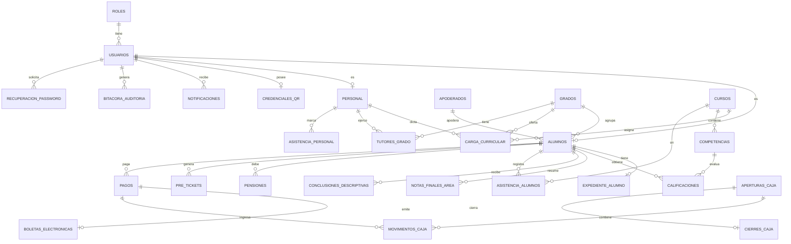

# 04 — Base de Datos

**Motor:** PostgreSQL 18.4 · **Base:** `siga_uc` · **Extensiones:** `pgcrypto`, `unaccent`,
`uuid-ossp` · **Zona horaria:** `America/Lima`

Fuente: `database/siga_uc.sql` (esquema) y `database/siga_uc_completo.sql` (esquema + datos).
El backup `siga_uc_backup.sql` no se versiona.

---

## 1. Panorama

| Módulo | Tablas | Total |
|---|---|---|
| Seguridad | `roles`, `usuarios`, `recuperacion_password`, `personal`, `asistencia_personal`, `bitacora_auditoria`, `notificaciones`, `credenciales_qr` | 8 |
| Curricular | `grados`, `cursos`, `competencias`, `carga_curricular`, `tutores_grado`, `horarios`, `escala_calificacion` | 7 |
| Alumnos | `apoderados`, `alumnos`, `expediente_alumno` | 3 |
| Asistencia | `asistencia_alumnos`, `resumen_asistencia_curso` | 2 |
| Calificaciones | `calificaciones`, `notas_finales_area`, `conclusiones_descriptivas`, `actas_bimestrales`, `libretas` | 5 |
| Tesorería | `conceptos_pago`, `becas`, `pensiones`, `pre_tickets`, `pagos`, `boletas_electronicas` | 6 |
| Caja | `cajas`, `aperturas_caja`, `movimientos_caja`, `cierres_caja` | 4 |
| SIAGIE | `exportaciones_siagie`, `estado_carga_docentes` | 2 |
| Reportes | `cuadro_merito`, `alumnos_riesgo` | 2 |
| **Total** | | **39** |

> **Tablas de solo estructura / históricas:** `resumen_asistencia_curso`, `libretas`,
> `cuadro_merito`, `alumnos_riesgo` y `estado_carga_docentes` existen en el esquema, pero el
> código actual calcula esa información al vuelo y **no la persiste**. No eliminarlas sin
> revisar el esquema y futuras funcionalidades.

---

## 2. Modelo relacional por módulo



---

## 3. Catálogo de tablas

### 3.1 Seguridad

#### `roles`
| Columna | Tipo | Restricción |
|---|---|---|
| `id_rol` | integer | PK |
| `nombre_rol` | varchar(50) | UNIQUE, CHECK `ADMIN/DOCENTE/SECRETARIA/ESTUDIANTE` |
| `descripcion` | varchar(200) | — |
| `fecha_creacion` | timestamp | default `now()` |

#### `usuarios`
| Columna | Tipo | Restricción |
|---|---|---|
| `id_usuario` | integer | PK |
| `dni` | char(8) | UNIQUE, CHECK 8 dígitos |
| `nombres`, `apellidos` | varchar(100) | NOT NULL |
| `correo_institucional` | varchar(150) | UNIQUE, NOT NULL (decorativo) |
| `correo_personal` | varchar(150) | NULL (real para envíos) |
| `password_hash` | varchar(255) | NOT NULL (bcrypt) |
| `telefono` | varchar(15) | — |
| `id_rol` | integer | FK → `roles(id_rol)` ON UPDATE CASCADE |
| `estado` | varchar(20) | CHECK `ACTIVO/INACTIVO/CESADO`, default `ACTIVO` |
| `requiere_cambio_password` | boolean | default `false` |
| `ultimo_login` | timestamp | — |
| `fecha_creacion` | timestamp | default `now()` |
| `fecha_actualizacion` | timestamp | actualizado por trigger |

#### `personal`
| Columna | Tipo | Restricción |
|---|---|---|
| `id_personal` | integer | PK |
| `id_usuario` | integer | UNIQUE, FK → `usuarios` ON DELETE CASCADE |
| `especialidad` | varchar(150) | — |
| `cargo` | varchar(100) | — |
| `fecha_ingreso` | date | — |
| `fecha_cese` | date | — |
| `motivo_cese` | varchar(200) | — |

#### `credenciales_qr`
| Columna | Tipo | Restricción |
|---|---|---|
| `id_credencial` | integer | PK |
| `id_usuario` | integer | UNIQUE, FK → `usuarios` ON DELETE CASCADE |
| `codigo_qr` | varchar(255) | UNIQUE |
| `tipo` | varchar(20) | CHECK `ESTUDIANTE/DOCENTE/ADMIN/SECRETARIA` |
| `fecha_emision` | timestamp | default `now()` |
| `activo` | boolean | default `true` |

#### `recuperacion_password`
| Columna | Tipo | Restricción |
|---|---|---|
| `id_recuperacion` | integer | PK |
| `id_usuario` | integer | FK → `usuarios` ON DELETE CASCADE |
| `token` | varchar(255) | UNIQUE |
| `fecha_solicitud` | timestamp | default `now()` |
| `fecha_expiracion` | timestamp | NOT NULL (NOW() + 2 h) |
| `usado` | boolean | default `false` |

#### `bitacora_auditoria`
| Columna | Tipo | Restricción |
|---|---|---|
| `id_bitacora` | bigint | PK |
| `id_usuario` | integer | FK → `usuarios` ON DELETE SET NULL |
| `fecha_hora` | timestamp | default `now()` |
| `modulo_afectado` | varchar(100) | NOT NULL |
| `accion` | varchar(50) | NOT NULL (`LOGIN`, `CREAR`, `MODIFICAR`, `ANULAR`, …) |
| `descripcion` | text | — |
| `valor_anterior` | jsonb | — |
| `valor_nuevo` | jsonb | — |
| `ip_origen` | varchar(45) | — |

#### `notificaciones`
| Columna | Tipo | Restricción |
|---|---|---|
| `id_notificacion` | integer | PK |
| `id_usuario_destino` | integer | FK → `usuarios` ON DELETE CASCADE |
| `id_usuario_remitente` | integer | FK → `usuarios` ON DELETE SET NULL |
| `asunto` | varchar(200) | NOT NULL |
| `cuerpo` | text | NOT NULL |
| `leido` | boolean | default `false` |
| `fecha_envio` | timestamp | default `now()` |

#### `asistencia_personal`
| Columna | Tipo | Restricción |
|---|---|---|
| `id_asistencia_personal` | integer | PK |
| `id_personal` | integer | FK → `personal` ON DELETE CASCADE |
| `fecha` | date | NOT NULL |
| `hora_ingreso`, `hora_salida` | time | — |
| `estado` | varchar(20) | CHECK `Puntual/Tardanza/Falta` o NULL |
| `observacion` | varchar(200) | — |
| — | — | UNIQUE (`id_personal`, `fecha`) |

### 3.2 Curricular

#### `grados`
`id_grado` PK · `nombre_grado` varchar(50) · `nivel` varchar(20) · `seccion` varchar(10) ·
`anio_lectivo` integer · UNIQUE (`nombre_grado`, `seccion`, `anio_lectivo`).

#### `cursos`
`id_curso` PK · `nombre_curso` varchar(100) UNIQUE · `area_academica` varchar(50) ·
`horas_semanales` integer.

#### `competencias`
`id_competencia` PK · `id_curso` FK → `cursos` ON DELETE CASCADE · `nombre_competencia`
varchar(250) · `orden` integer.

#### `carga_curricular`
`id_carga` PK · `id_grado` FK → `grados` ON DELETE CASCADE · `id_curso` FK → `cursos` ON
DELETE CASCADE · `id_personal` FK → `personal` ON DELETE CASCADE · `anio_lectivo` integer ·
`horas_asignadas` integer · UNIQUE (`id_grado`, `id_curso`, `anio_lectivo`).

#### `tutores_grado`
`id_tutor` PK · `id_grado` FK → `grados` ON DELETE CASCADE · `id_personal` FK → `personal` ON
DELETE CASCADE · `anio_lectivo` integer · UNIQUE (`id_grado`, `anio_lectivo`).

#### `horarios`
`id_horario` PK · `id_grado` FK → `grados` ON DELETE CASCADE · `id_curso` FK → `cursos` ON
DELETE SET NULL · `id_personal` FK → `personal` ON DELETE SET NULL · `dia_semana` CHECK
`Lunes..Sábado` · `hora_inicio`, `hora_fin` · `tipo_bloque` CHECK `CLASE/RECREO/ALMUERZO` ·
CHECK `hora_fin > hora_inicio`.

#### `escala_calificacion`
`id_escala` PK · `codigo` varchar(5) UNIQUE CHECK `AD/A/B/C` · `descripcion` · `orden`.

### 3.3 Alumnos

#### `apoderados`
`id_apoderado` PK · `nombres`, `apellidos` NOT NULL · `dni` char(8) UNIQUE (nullable) ·
`telefono` · `correo`.

#### `alumnos`
| Columna | Tipo | Restricción |
|---|---|---|
| `id_alumno` | integer | PK |
| `id_usuario` | integer | UNIQUE, FK → `usuarios` ON DELETE CASCADE |
| `dni` | char(8) | UNIQUE, CHECK 8 dígitos |
| `nombres`, `apellidos` | varchar(100) | NOT NULL |
| `fecha_nacimiento` | date | NOT NULL |
| `id_apoderado` | integer | FK → `apoderados` ON DELETE SET NULL |
| `id_grado` | integer | FK → `grados` ON DELETE SET NULL |
| `condicion` | varchar(20) | CHECK `Regular/Traslado/Retirado` |
| `colegio_procedencia` | varchar(200) | — |
| `estado_matricula` | varchar(30) | CHECK `Matriculado/PendientePago/Retirado` |
| `fecha_retiro` | date | — |
| `motivo_retiro`, `colegio_destino` | varchar(200) | — |
| `resolucion_directoral` | varchar(100) | — |
| `codigo_estudiante` | varchar(20) | UNIQUE (`EST-XXX`) |
| `anio_lectivo` | integer | NOT NULL |
| `fecha_creacion` | timestamp | default `now()` |

#### `expediente_alumno`
`id_expediente` PK · `id_alumno` UNIQUE FK → `alumnos` ON DELETE CASCADE ·
`nivel_logro_actual` varchar(5) · `asistencia_acumulada` numeric(5,2) · `congelado` boolean
default `false`.

### 3.4 Asistencia

#### `asistencia_alumnos`
`id_asistencia` PK · `id_alumno` FK → `alumnos` ON DELETE CASCADE · `id_curso` FK → `cursos`
ON DELETE CASCADE · `id_personal` FK → `personal` ON DELETE SET NULL · `id_grado` FK →
`grados` ON DELETE CASCADE · `fecha` date · `dia_semana` varchar(15) · `estado` char(1) CHECK
`P/T/F` · `observacion` varchar(250) · `justificada` boolean default `false` ·
`motivo_justificacion` varchar(250) · `fecha_registro` timestamp · UNIQUE (`id_alumno`,
`id_curso`, `fecha`).

#### `resumen_asistencia_curso` (estructura, no persistida por el código)
`id_resumen` PK · `id_alumno` FK · `id_curso` FK · `porcentaje_asistencia` · `total_presente`
· `total_tardanza` · `total_falta` · UNIQUE (`id_alumno`, `id_curso`).

### 3.5 Calificaciones

#### `calificaciones`
`id_calificacion` PK · `id_alumno` FK → `alumnos` ON DELETE CASCADE · `id_curso` FK →
`cursos` ON DELETE CASCADE · `id_competencia` FK → `competencias` ON DELETE CASCADE ·
`id_personal` FK → `personal` ON DELETE SET NULL · `id_grado` FK → `grados` ON DELETE CASCADE
· `bimestre` integer CHECK 1–4 · `anio_lectivo` integer · `calificacion` varchar(5) CHECK
`AD/A/B/C` · `fecha_registro` · `fecha_modificacion` · `modificado_por` FK → `usuarios` ON
DELETE SET NULL · `justificacion_modificacion` text · UNIQUE (`id_alumno`, `id_curso`,
`id_competencia`, `bimestre`, `anio_lectivo`).

#### `notas_finales_area`
`id_nota_final` PK · `id_alumno` FK · `id_curso` FK · `bimestre` CHECK 1–4 · `anio_lectivo` ·
`nota_final` CHECK `AD/A/B/C` · `calculo_automatico` boolean default `true` · UNIQUE
(`id_alumno`, `id_curso`, `bimestre`, `anio_lectivo`).

#### `conclusiones_descriptivas`
`id_conclusion` PK · `id_alumno` FK · `id_curso` FK · `bimestre` · `anio_lectivo` ·
`descripcion` text · `id_personal` FK → `personal` ON DELETE SET NULL · UNIQUE (`id_alumno`,
`id_curso`, `bimestre`, `anio_lectivo`).

#### `actas_bimestrales`
`id_acta` PK · `periodo` varchar(30) · `anio_lectivo` · `id_grado` FK → `grados` ON DELETE
CASCADE (nullable) · `estado` CHECK `ABIERTO/CERRADO` default `ABIERTO` · `fecha_cierre` ·
`cerrado_por` FK → `usuarios` ON DELETE SET NULL · `hash_integridad` varchar(255).

#### `libretas` (estructura, no persistida por el código)
`id_libreta` PK · `id_alumno` FK · `bimestre` · `anio_lectivo` · `id_tutor` FK → `personal` ON
DELETE SET NULL · `fecha_emision` · `promedio_general` varchar(5) · `asistencia_global`
numeric(5,2) · UNIQUE (`id_alumno`, `bimestre`, `anio_lectivo`).

### 3.6 Tesorería

#### `conceptos_pago`
`id_concepto` PK · `nombre` varchar(100) · `monto_base` numeric(10,2) · `tipo` CHECK
`MATRICULA/PENSION/OTROS` · `mes` integer CHECK 1–12 (nullable) · `anio_lectivo`.

#### `becas`
`id_beca` PK · `id_alumno` FK → `alumnos` ON DELETE CASCADE · `tipo` CHECK
`SOCIOECONOMICA/HERMANOS/EXCELENCIA` · `porcentaje_descuento` numeric(5,2) CHECK 0–100 ·
`monto_descuento` numeric(10,2) · `fecha_inicio` date · `fecha_fin` date · `activo` boolean
default `true`.

#### `pensiones`
`id_pension` PK · `id_alumno` FK → `alumnos` ON DELETE CASCADE · `anio_lectivo` · `mes`
CHECK 1–12 · `monto_base` · `descuento` default 0 · `monto_final` · `estado` CHECK
`PAGADO/PENDIENTE/ANULADO` default `PENDIENTE` · `id_beca` FK → `becas` ON DELETE SET NULL · UNIQUE
(`id_alumno`, `anio_lectivo`, `mes`). Las pensiones `ANULADO` no se cobran y pueden
volver a `PENDIENTE` al regenerar el cronograma (H45).

#### `pre_tickets`
`id_preticket` PK · `id_alumno` FK → `alumnos` ON DELETE CASCADE · `id_concepto` FK →
`conceptos_pago` ON DELETE CASCADE · `monto` · `estado` CHECK `PENDIENTE/PAGADO/ANULADO` ·
`fecha_emision` · `fecha_pago` · `id_usuario_emite` FK → `usuarios` ON DELETE SET NULL.

#### `pagos`
`id_pago` PK · `id_alumno` FK → `alumnos` ON DELETE CASCADE · `id_preticket` FK → `pre_tickets`
ON DELETE SET NULL · `id_pension` FK → `pensiones` ON DELETE SET NULL · `id_concepto` FK →
`conceptos_pago` ON DELETE CASCADE · `monto` numeric(10,2) · `forma_pago` CHECK
`Efectivo/Yape/Plin/Interbank/BCP/BBVA` · `nro_operacion` · `fecha_pago` · `id_usuario_cobrador`
FK → `usuarios` ON DELETE SET NULL · `estado` CHECK `PAGADO/ANULADO` default `PAGADO`.

#### `boletas_electronicas`
`id_boleta` PK · `id_pago` FK → `pagos` ON DELETE CASCADE · `numero_boleta` varchar(20) UNIQUE ·
`serie` varchar(10) · `numero` integer · `fecha_emision` · `monto_total` · `estado_sunat` CHECK
`ACEPTADO/PENDIENTE/RECHAZADO` (nullable) · `xml_url`, `pdf_url`, `hash_cpe`.

### 3.7 Caja

#### `cajas`
`id_caja` PK · `nombre_caja` varchar(100) · `responsable` FK → `usuarios` ON DELETE SET NULL ·
`estado` CHECK `ABIERTA/CERRADA` default `CERRADA`.

#### `aperturas_caja`
`id_apertura` PK · `id_caja` FK → `cajas` ON DELETE CASCADE · `monto_inicial` numeric(10,2) ·
`id_usuario_apertura` FK → `usuarios` ON DELETE SET NULL · `fecha_apertura` default `now()` ·
`observaciones` text.

#### `movimientos_caja`
`id_movimiento` PK · `id_apertura` FK → `aperturas_caja` ON DELETE CASCADE · `id_pago` FK →
`pagos` ON DELETE SET NULL · `tipo` CHECK `INGRESO/EGRESO/APERTURA` · `concepto` varchar(250) ·
`monto` · `medio_pago` · `nro_comprobante` · `fecha_hora` · `id_usuario` FK → `usuarios` ON
DELETE SET NULL.

#### `cierres_caja`
`id_cierre` PK · `id_apertura` FK → `aperturas_caja` ON DELETE CASCADE · `monto_apertura` ·
`total_ingresos_efectivo` · `total_ingresos_digital` · `total_egresos` · `efectivo_esperado` ·
`efectivo_fisico` · `diferencia` · `total_general` · `id_usuario_cierre` FK → `usuarios` ON
DELETE SET NULL · `fecha_cierre` · `estado` CHECK `CUADRADO/SOBRANTE/FALTANTE`.

### 3.8 SIAGIE y reportes

#### `exportaciones_siagie`
`id_exportacion` PK · `id_grado` FK → `grados` ON DELETE CASCADE · `bimestre` · `anio_lectivo` ·
`nombre_archivo` · `fecha_generacion` · `id_usuario` FK → `usuarios` ON DELETE SET NULL ·
`estado`.

#### `estado_carga_docentes` (estructura, calculada al vuelo)
`id_estado_carga` PK · `id_personal` FK · `id_curso` FK · `id_grado` FK · `bimestre` ·
`total_alumnos` · `alumnos_calificados` · `porcentaje` · `estado` CHECK
`COMPLETO/PENDIENTE`.

#### `cuadro_merito` (estructura, calculada al vuelo)
`id_cuadro` PK · `id_alumno` FK · `id_grado` FK · `bimestre` · `anio_lectivo` · `puesto` ·
`predominancia_logro` · `merito` · UNIQUE (`id_alumno`, `bimestre`, `anio_lectivo`).

#### `alumnos_riesgo` (estructura, calculada al vuelo)
`id_riesgo` PK · `id_alumno` FK · `id_grado` FK · `bimestre` · `cursos_logro_c` text · `id_tutor`
FK → `personal` ON DELETE SET NULL · `accion_correctiva` text · UNIQUE (`id_alumno`,
`bimestre`).

---

## 4. Restricciones de negocio en BD (CHECK)

| Tabla | Columna | Valores |
|---|---|---|
| `roles` | `nombre_rol` | ADMIN, DOCENTE, SECRETARIA, ESTUDIANTE |
| `usuarios` | `estado` | ACTIVO, INACTIVO, CESADO |
| `usuarios`, `alumnos` | `dni` | `^[0-9]{8}$` |
| `alumnos` | `condicion` | Regular, Traslado, Retirado |
| `alumnos` | `estado_matricula` | Matriculado, PendientePago, Retirado |
| `asistencia_alumnos` | `estado` | P, T, F |
| `asistencia_personal` | `estado` | Puntual, Tardanza, Falta (o NULL) |
| `calificaciones` | `calificacion` | AD, A, B, C |
| `calificaciones`, `notas_finales_area`, `conclusiones_descriptivas` | `bimestre` | 1–4 |
| `escala_calificacion` | `codigo` | AD, A, B, C |
| `conceptos_pago` | `tipo` | MATRICULA, PENSION, OTROS |
| `conceptos_pago` | `mes` | 1–12 o NULL |
| `pensiones` | `mes` | 1–12 |
| `pensiones` | `estado` | PAGADO, PENDIENTE, ANULADO |
| `pre_tickets` | `estado` | PENDIENTE, PAGADO, ANULADO |
| `pagos` | `forma_pago` | Efectivo, Yape, Plin, Interbank, BCP, BBVA |
| `pagos` | `estado` | PAGADO, ANULADO |
| `boletas_electronicas` | `estado_sunat` | ACEPTADO, PENDIENTE, RECHAZADO |
| `cajas` | `estado` | ABIERTA, CERRADA |
| `movimientos_caja` | `tipo` | INGRESO, EGRESO, APERTURA |
| `cierres_caja` | `estado` | CUADRADO, SOBRANTE, FALTANTE |
| `horarios` | `dia_semana` | Lunes … Sábado |
| `horarios` | `tipo_bloque` | CLASE, RECREO, ALMUERZO |
| `horarios` | `hora_fin` | > `hora_inicio` |
| `actas_bimestrales` | `estado` | ABIERTO, CERRADO |
| `becas` | `tipo` | SOCIOECONOMICA, HERMANOS, EXCELENCIA |
| `becas` | `porcentaje_descuento` | 0–100 |
| `credenciales_qr` | `tipo` | ESTUDIANTE, DOCENTE, ADMIN, SECRETARIA |

---

## 5. Índices

Además de los índices automáticos de PK/UNIQUE, el esquema define **25 índices btree**:

| Tabla | Índices |
|---|---|
| `alumnos` | `anio_lectivo`, `dni`, `estado_matricula`, `id_grado` |
| `asistencia_alumnos` | `id_alumno`, `(id_curso, fecha)`, `fecha` |
| `asistencia_personal` | `fecha` |
| `bitacora_auditoria` | `fecha_hora`, `modulo_afectado`, `id_usuario` |
| `calificaciones` | `(id_alumno, id_curso)`, `(bimestre, anio_lectivo)` |
| `carga_curricular` | `id_personal` |
| `competencias` | `id_curso` |
| `grados` | `anio_lectivo` |
| `horarios` | `(id_grado, dia_semana)` |
| `notificaciones` | `(id_usuario_destino, leido)` |
| `pagos` | `id_alumno`, `fecha_pago` |
| `personal` | `id_usuario` |
| `recuperacion_password` | `token` |
| `usuarios` | `correo_institucional`, `dni`, `id_rol` |

---

## 6. Funciones y triggers (11 objetos)

### 6.1 `trg_actualizar_timestamp()`
Trigger `trg_usuarios_actualizar` **BEFORE UPDATE** en `usuarios`. Asigna
`fecha_actualizacion = NOW()`.

### 6.2 `trg_auditar_calificacion()`
Trigger `trg_calificaciones_audit` **AFTER INSERT OR UPDATE** en `calificaciones`.

- Usuario: `COALESCE(NEW.modificado_por, OLD.modificado_por)`.
- Módulo: `Evaluaciones`.
- Acción: `CREAR` en INSERT, `MODIFICAR` en UPDATE.
- Descripción: `Calificación alumno ID <id>`.
- `valor_anterior`: JSONB con la calificación anterior (solo UPDATE).
- `valor_nuevo`: JSONB con la nueva calificación.

> Es el **único trigger que alimenta la bitácora**. El login y las operaciones
> administrativas no se auditan automáticamente.

### 6.3 `trg_actualizar_preticket()`
Trigger `trg_pagos_preticket` **AFTER INSERT** en `pagos`. Si `NEW.id_preticket` no es NULL,
marca el pre-ticket como `PAGADO` y `fecha_pago = NOW()`.

### 6.4 `trg_actualizar_pension()`
Trigger `trg_pagos_pension` **AFTER INSERT** en `pagos`. Si `NEW.id_pension` no es NULL, marca
la pensión como `PAGADO`.

### 6.5 `trg_pago_a_caja()`
Trigger `trg_pagos_mov_caja` **AFTER INSERT** en `pagos`. Busca la **última apertura**
(`ORDER BY fecha_apertura DESC LIMIT 1`) y registra un `INGRESO` en `movimientos_caja` con el
monto, forma de pago y cobrador.

> No verifica que la apertura esté abierta (sin cierre). Ver hallazgos.

### 6.6 `calcular_nota_final_area(p_id_alumno, p_id_curso, p_bimestre, p_anio)`
Función PL/pgSQL que cuenta `AD/A/B/C` y devuelve:

- `AD` si hay ≥2 AD.
- `A` si hay ≥2 A.
- `B` si hay ≥2 B.
- En cualquier otro caso, `C`.

> **Divergencia:** el DAO `calificacionDao.calcularNotaFinal` agrega un desempate por la mejor
> nota cuando ninguna alcanza 2. La función SQL no. El backend usa el DAO; la función queda
> como respaldo/legado. Ver hallazgos.

### 6.7 Duplicación app ↔ triggers
`tesoreriaDao.registrarPago` actualiza manualmente pre-ticket, pensión y matrícula, y además
los triggers 6.3/6.4/6.5 hacen lo mismo. Las operaciones son idempotentes, pero hay
duplicación de lógica. El movimiento de caja solo lo crea el trigger.

---

## 7. Datos de ejemplo (`siga_uc_completo.sql`)

| Entidad | Registros | Detalle |
|---|---|---|
| Roles | 4 | ADMIN(1), DOCENTE(2), SECRETARIA(3), ESTUDIANTE(4) |
| Usuarios | 29 | 1 admin, 1 secretaria, 6 docentes (1 cesado), 21 estudiantes |
| Alumnos | 21 | 20 activos + 1 retirado; 3 en `PendientePago` |
| Personal | 7 | Docentes + secretaría; 1 cesado |
| Grados | 5 | 1.º a 5.º de secundaria, sección única, 2026 |
| Cursos | 11 | Matemáticas (5), Lenguaje (2), Ciencias Naturales (2), Sociales (2) |
| Competencias | 29 | 2–4 por curso |
| Carga curricular | 54 | 11 cursos × 5 grados aprox. |
| Tutores | 5 | Uno por grado |
| Horarios | 13 | Solo 2.º de secundaria, Lunes–Miércoles en el seed |
| Conceptos de pago | 11 | Matrícula + pensiones marzo–diciembre |
| Pensiones | 180 | 18 alumnos × 10 meses aprox. |
| Pagos | 10 | Con boletas `B001-004821..4830` |
| Asistencias de alumnos | 14 | P/T/F de ejemplo |
| Asistencias de personal | 2 | Puntual/Tardanza |
| Notificaciones | 8 | Buzón de ejemplo |
| Credenciales QR | 29 | Una por usuario |
| Actas | 2 | 1.º y 2.º bimestre |
| Exportaciones SIAGIE | 4 | Historial de ejemplo |
| Bitácora | 8 | Registros manuales de ejemplo |

> Los datos semilla son **ficticios**. No usarlos en producción.

---

## 8. Consultas operativas útiles

```sql
-- Verificar tablas
SELECT table_name FROM information_schema.tables
WHERE table_schema = 'public' ORDER BY table_name;

-- Usuarios y roles
SELECT u.dni, u.nombres || ' ' || u.apellidos AS nombre, r.nombre_rol, u.estado
FROM usuarios u JOIN roles r ON r.id_rol = u.id_rol
ORDER BY r.id_rol, u.apellidos;

-- Alumnos por estado
SELECT estado_matricula, COUNT(*) FROM alumnos GROUP BY 1;

-- Notas finales por alumno/bimestre
SELECT a.dni, c.nombre_curso, nf.bimestre, nf.nota_final
FROM notas_finales_area nf
JOIN alumnos a ON a.id_alumno = nf.id_alumno
JOIN cursos c ON c.id_curso = nf.id_curso
WHERE nf.anio_lectivo = 2026
ORDER BY a.apellidos, c.nombre_curso, nf.bimestre;

-- Caja abierta
SELECT ap.* FROM aperturas_caja ap
WHERE NOT EXISTS (SELECT 1 FROM cierres_caja cc WHERE cc.id_apertura = ap.id_apertura)
ORDER BY ap.fecha_apertura DESC LIMIT 1;

-- Triggers instalados
SELECT event_object_table, trigger_name, action_timing, event_manipulation
FROM information_schema.triggers
WHERE trigger_schema = 'public'
ORDER BY event_object_table;
```

---

## 9. Restauración

```powershell
# Instalación nueva: un solo dump completo + migraciones en orden
createdb -U postgres siga_uc

psql -U postgres -d siga_uc -f database/siga_uc_completo.sql
psql -U postgres -d siga_uc -f database/migracion_h32_anulacion_pagos.sql
psql -U postgres -d siga_uc -f database/migracion_h10_h38_concurrencia_pagos.sql
psql -U postgres -d siga_uc -f database/migracion_h07_auditoria.sql
```

> `siga_uc_completo.sql` ya contiene esquema, funciones e índices. **No** cargar
> `siga_uc.sql` junto con él: es solo la referencia del esquema. Las migraciones son
> idempotentes y se aplican en orden.
>
> `siga_uc.sql` incluye la meta-orden `\restrict` de `pg_dump` 18. Si se consulta con una
> versión anterior de `psql`, puede fallar; en ese caso usar `siga_uc_completo.sql` o eliminar
> esa línea.
