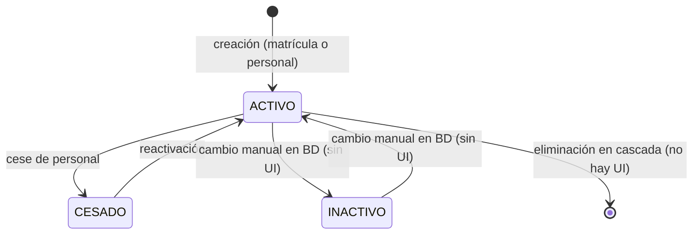

# 06 — Usuarios, Roles y Permisos

## 1. Modelo de roles

| ID | Rol | Descripción en BD | Uso real |
|---|---|---|---|
| 1 | `ADMIN` | Administrador General del sistema | Control total |
| 2 | `DOCENTE` | Docente de aula | Asistencia, notas, ficha, reportes de aula |
| 3 | `SECRETARIA` | Secretaría y Tesorería | Padrón, tesorería, caja, QR de personal |
| 4 | `ESTUDIANTE` | Cuenta de estudiante | Consulta de notas, asistencia y horario de su matrícula anual |

Restricción en BD:

```sql
CHECK (nombre_rol IN ('ADMIN','DOCENTE','SECRETARIA','ESTUDIANTE'))
```

### 1.1 Módulo Personal vs. estudiantes

- El módulo **Personal** solo admite roles `ADMIN` (1), `DOCENTE` (2) y
  `SECRETARIA` (3). `ESTUDIANTE` (4) nunca se crea ni se edita desde este módulo.
- **Especialidad** es exclusiva de `DOCENTE`. `ADMIN` y `SECRETARIA` no tienen
  especialidad; el backend la guarda como `NULL` aunque llegue un valor.
- **Cargo** aplica a todos los roles (Director, Secretaría, Docente de Matemática...).
- Al editar un trabajador, cambiar de `DOCENTE` a otro rol limpia la especialidad.
  Al volver a `DOCENTE`, el campo aparece vacío para completarlo.
- El selector de roles del frontend filtra `ESTUDIANTE` tanto en el alta, la edición y
  el filtro superior de la lista.

No existe tabla de permisos por rol. Los permisos están **codificados** en:

- Backend: `verificarRol(...)` en cada router.
- Frontend: `roleGuard([...])` en `app.routes.ts`.
- UI: menús de cada sidebar.

## 2. Ciclo de vida de una cuenta



### 2.1 Identidad vs. matrícula anual (H49/6.1)

- `usuarios` es la **identidad**: DNI único, credencial QR única, login único.
- `alumnos` es la **matrícula anual**: una fila por año. El mismo `id_usuario` puede tener
  una fila en 2026 y otra en 2027 con distinto grado, sección, código y estado.
- Los UNIQUE globales de `alumnos.dni`, `alumnos.id_usuario` y
  `alumnos.codigo_estudiante` ya no existen; se reemplazaron por
  `(dni, anio_lectivo)`, `(id_usuario, anio_lectivo)` y `(codigo_estudiante, anio_lectivo)`.
- El apoderado también es identidad: se reutiliza por DNI al matricular a un hermano y no se
  sobrescriben sus nombres ni contactos existentes.
- Los apoderados, expedientes, credenciales QR y datos de `usuarios` no se duplican por año.

- El login exige `estado = 'ACTIVO'`.
- `CESADO` e `INACTIVO` no pueden iniciar sesión.
- El middleware revalida el estado en cada request: un usuario cesado o retirado queda
  bloqueado aunque su JWT no haya expirado (H02).
- El retiro de una matrícula anual pasa `alumnos.estado_matricula` a `Retirado`, congela el
  expediente (H19) y anula pensiones/pre-tickets futuros (H45). El usuario pasa a `INACTIVO`
  **solo si no le queda otra matrícula no retirada** en ningún año; si tiene una matrícula
  vigente en otro año, conserva el acceso (H49).
- Una cuenta `ESTUDIANTE` puede existir sin matrícula en el año activo. El login funciona y
  devuelve `info_adicional.matricula_activa = false`; las vistas académicas muestran el
  mensaje “Sin matrícula {año}” y la API responde `403 SIN_MATRICULA_ACTIVA` cuando intenta
  resolver datos propios que dependen de la matrícula.

## 3. Autenticación

### 3.1 Credenciales

- Usuario: **DNI de 8 dígitos** (no correo).
- Contraseña: mínimo 6 caracteres.
- Hash: bcrypt coste 10 (`crypt(..., gen_salt('bf',10))` en PostgreSQL).
- Verificación: `bcrypt.compare` en Node.
- Sesión: JWT firmado con `JWT_SECRET`, expira en `JWT_EXPIRES_IN` (por defecto `8h`).
- Almacenamiento frontend: `localStorage` (`siga_uc_token`, `siga_uc_user`).

### 3.2 Contraseñas por defecto

| Colectivo | Contraseña | Se fuerza cambio |
|---|---|---|
| Admin/Secretaría/Docentes creados desde UI | `UC2026*` o la definida al crear | Sí (H18) |
| Alumno matriculado | `UC<DNI>` | Sí (H18) |
| Reset por Admin/Personal | `UC<DNI>` | Sí: marca `requiere_cambio_password = TRUE` |
| Recuperación por correo | La elige el usuario | No: se limpia la marca |

> Si `requiere_cambio_password = TRUE`, el login redirige a `/cambiar-password` y el backend
> bloquea todos los endpoints salvo el cambio de contraseña, el perfil, la verificación de
> token y el logout. El flag se limpia al cambiar la contraseña.

> El año lectivo activo se lee de `anios_lectivos.estado='ACTIVO'` al arrancar el backend y
> se expone al frontend en `GET /api/configuracion`; `ANIO_LECTIVO` solo es bootstrap/respaldo.
> No hay año hardcodeado en la UI. El login y el perfil resuelven la matrícula del año activo,
> no “la primera” del usuario.

## 4. Matriz de permisos efectivos (API)

Leyenda: ✅ permitido · ❌ denegado · 👁 solo lectura · 🔒 solo sus propios datos (cuando aplica)

| Capacidad / módulo | ADMIN | SECRETARIA | DOCENTE | ESTUDIANTE |
|---|---|---|---|---|
| Login / logout / perfil | ✅ | ✅ | ✅ | ✅ |
| Configuración del sistema (año lectivo) | Público | Público | Público | Público |
| Cambiar contraseña propia | ✅ | ✅ | ✅ | ✅ |
| Recuperar contraseña | ✅ | ✅ | ✅ | ✅ |
| Dashboard ejecutivo (`/reportes/dashboard`) | ✅ | ✅ | ❌ | ❌ |
| Alumnos: listar / ver / buscar | ✅ | ✅ | 👁 | 👁 |
| Alumnos: crear / editar / retirar | ✅ | ✅ | ❌ | ❌ |
| Reset password por DNI | ✅ | ❌ | ❌ | ❌ |
| Personal: listar / ver | ✅ | 👁 | 👁 | 👁 |
| Personal: crear / editar / cesar / reactivar / reset | ✅ | ❌ | ❌ | ❌ |
| Grados / cursos / competencias / escala | ✅ | ✅ | ✅ | ✅ |
| Carga curricular: consultar | ✅ | ✅ | ✅ | ✅ |
| Carga curricular: crear / editar / eliminar / tutor | ✅ | ❌ | ❌ | ❌ |
| Horarios: consultar | ✅ | ✅ | 👁 (solo suyo) | 👁 (solo su grado) |
| Horarios: crear / editar / eliminar / publicar / generar | ✅ | ❌ | ❌ | ❌ |
| Horarios: malla de períodos | ✅ | 👁 | 👁 | 👁 |
| Asistencia alumnos: consultar | ✅ | ✅ | ✅ | ✅ |
| Asistencia alumnos: registrar / masivo | ✅ | ❌ | ✅ | ❌ |
| Asistencia personal: consultar | ✅ | ✅ | ✅ | ✅ |
| Asistencia personal: marcar | ✅ | ✅ | ❌ | ❌ |
| Calificaciones: consultar | ✅ | ✅ | ✅ | ✅ |
| Calificaciones: registrar / masivo | ✅ | ❌ | ✅ | ❌ |
| Nota final: calcular | ✅ | ❌ | ✅ | ❌ |
| Conclusiones descriptivas: consultar / guardar | ✅ | ✅ (sus cursos) | ❌ | ❌ |
| Tesorería: consultar | ✅ | ✅ | ✅ | ✅ |
| Tesorería: pre-ticket / pago / generar pensiones | ✅ | ✅ | ❌ | ❌ |
| Becas: aplicar / aprobar / anular | ✅ | ❌ | ❌ | ❌ |
| Configuración: leer tarifas, académico, jornada y becas | ✅ | ❌ | ✅ | ❌ |
| Configuración: escribir tarifas, académico, jornada y becas | ✅ | ❌ | ❌ | ❌ |
| Primera configuración (`/setup`) | Público solo con `SETUP_TOKEN`, mientras no exista ADMIN | ❌ | ❌ | ❌ |
| Caja: consultar | ✅ | ✅ | ✅ | ✅ |
| Caja: aperturar / egreso / cerrar | ✅ | ✅ | ❌ | ❌ |
| Reportes: cuadro de mérito / riesgo / asistencia | ✅ | ❌ | ✅ | ❌ |
| Libreta (`/reportes/libreta/:id`) | ✅ | ✅ | ✅ | ✅ (sin validar pertenencia) |
| SIAGIE | ✅ | ❌ | ❌ | ❌ |
| Auditoría: consultar bitácora/actas | ✅ | ✅ | ✅ | ✅ |
| Auditoría: cerrar acta | ✅ | ❌ | ❌ | ❌ |
| Notificaciones: propias | ✅ | ✅ | ✅ | ✅ |
| Notificaciones: enviar a un usuario | ✅ | ❌ | ✅ | ❌ |
| Notificaciones: envío masivo | ✅ | ❌ | ❌ | ❌ |
| Carné QR / perfil | ✅ | ✅ | ✅ | ✅ |

> **Brecha crítica:** las filas “consultar” de alumnos, personal, calificaciones, tesorería,
> caja y auditoría son accesibles para **cualquier usuario autenticado**. La UI oculta el
> módulo, pero un estudiante con token puede consultar datos de otros alumnos, pagos y
> bitácora llamando la API. Ver `15-HALLAZGOS`.

## 5. Matriz de navegación (UI)

| Ruta | Componente | ADMIN | SECRETARIA | DOCENTE | ESTUDIANTE |
|---|---|---|---|---|---|
| `/login` | Login | Público | Público | Público | Público |
| `/reset-password` | Reset | Público | Público | Público | Público |
| `/cambiar-password` | Cambio obligatorio/voluntario | Autenticado | Autenticado | Autenticado | Autenticado |
| `/admin` | Dashboard | ✅ | ❌ | ❌ | ❌ |
| `/admin/alumnos` | Padrón | ✅ | ❌ | ❌ | ❌ |
| `/admin/personal` | Personal | ✅ | ❌ | ❌ | ❌ |
| `/admin/carga-curricular` | Carga | ✅ | ❌ | ❌ | ❌ |
| `/admin/asistencia-qr` | QR personal | ✅ | ❌ | ❌ | ❌ |
| `/admin/tesoreria` | Tesorería (wrapper) | ✅ | ❌ | ❌ | ❌ |
| `/admin/caja` | Caja (wrapper) | ✅ | ❌ | ❌ | ❌ |
| `/admin/siagie` | SIAGIE | ✅ | ❌ | ❌ | ❌ |
| `/admin/reportes` | Reportes | ✅ | ❌ | ❌ | ❌ |
| `/admin/auditoria` | Auditoría | ✅ | ❌ | ❌ | ❌ |
| `/secretaria` | Dashboard financiero | ❌ | ✅ | ❌ | ❌ |
| `/secretaria/padron` | Padrón (wrapper) | ❌ | ✅ | ❌ | ❌ |
| `/secretaria/tesoreria` | Tesorería | ❌ | ✅ | ❌ | ❌ |
| `/secretaria/caja` | Caja | ❌ | ✅ | ❌ | ❌ |
| `/secretaria/asistencia-qr` | QR (wrapper) | ❌ | ✅ | ❌ | ❌ |
| `/secretaria/horarios` | Horarios (solo lectura) | ❌ | ✅ | ❌ | ❌ |
| `/admin/horarios` | Horarios (edición) | ✅ | ❌ | ❌ | ❌ |
| `/docente` | Mis cursos | ❌ | ❌ | ✅ | ❌ |
| `/docente/horario` | Mi horario | ❌ | ❌ | ✅ | ❌ |
| `/docente/notas` | Notas | ❌ | ❌ | ✅ | ❌ |
| `/docente/conclusiones` | Conclusiones descriptivas | ❌ | ❌ | ✅ | ❌ |
| `/docente/asistencia` | Asistencia | ❌ | ❌ | ✅ | ❌ |
| `/docente/ficha-estudiante` | Ficha | ❌ | ❌ | ✅ | ❌ |
| `/docente/reportes` | Reportes de aula | ❌ | ❌ | ✅ | ❌ |
| `/estudiante` | Mis notas | ❌ | ❌ | ❌ | ✅ |
| `/estudiante/asistencia` | Mi asistencia | ❌ | ❌ | ❌ | ✅ |
| `/estudiante/horario` | Horario | ❌ | ❌ | ❌ | ✅ |
| `/en-construccion` | Placeholder | ✅ | ✅ | ✅ | ✅ |

**Redirección por rol:** login → `/admin`, `/secretaria`, `/docente` o `/estudiante`.
Si un usuario intenta una ruta de otro rol, `roleGuard` lo devuelve a su dashboard.

## 6. Usuarios semilla (29)

> Estos son los usuarios del script `siga_uc_completo.sql`. Si la base de producción tiene
> usuarios reales, consúltalos con `SELECT id_usuario, dni, nombres, apellidos, id_rol, estado FROM usuarios;`.
> Los datos de abajo son ficticios y sirven para desarrollo/pruebas.

> Datos ficticios de `siga_uc_completo.sql`. Contraseñas según `docs/CREDENCIALES.md`.
> `requiere_cambio_password` se indica cuando está activo.

### 6.1 Administración y secretaría

| ID | DNI | Nombre | Rol | Estado | Contraseña |
|---|---|---|---|---|---|
| 1 | 74829102 | Yarol Bello Coquil | ADMIN | ACTIVO | `UC2026*` |
| 2 | 40596837 | Sofia Patricia Vargas Luna | SECRETARIA | ACTIVO | `UC2026*` |

### 6.2 Docentes

| ID | DNI | Nombre | Especialidad / cargo | Estado | Contraseña |
|---|---|---|---|---|---|
| 3 | 10293847 | Juan Carlos Pérez Huamán | Matemática | ACTIVO (requiere cambio) | `UC2026*` |
| 4 | 20394812 | Ricardo Manuel Gómez Torres | Ciencias Sociales | ACTIVO | `UC2026*` |
| 5 | 30192847 | Giancarlo Vilchez Rojas | Ciencias Naturales | ACTIVO | `UC2026*` |
| 6 | 50182736 | Anel Adela Aguilar Rojas | Comunicación | ACTIVO | `UC2026*` |
| 27 | 19873022 | Berna Coquil Laura | Música | **CESADO** | — |
| 28 | 56781234 | Test Prueba | Docente de prueba | ACTIVO | `UC2026*` |

### 6.3 Estudiantes

| ID | DNI | Nombre | Grado | Estado matrícula | Contraseña |
|---|---|---|---|---|---|
| 7 | 75918234 | Anel Adela Palomino Rojas | 3.º | Matriculado | `UC75918234` |
| 8 | 74829103 | Renato Mijael Velasque Pocco | 2.º | Matriculado | `UC74829103` |
| 9 | 76829401 | Yazid Ismael Suárez Quispe | 5.º | Matriculado | `UC76829401` |
| 10 | 70000001 | Luis García | 1.º | Matriculado | `UC70000001` |
| 11 | 70000002 | Ana Rodríguez | 2.º | Matriculado | `UC70000002` |
| 12 | 70000003 | Diego Martínez | 3.º | Matriculado | `UC70000003` |
| 13 | 70000004 | Sofía López | 4.º | Matriculado | `UC70000004` |
| 14 | 70000005 | Mateo González | 5.º | Matriculado | `UC70000005` |
| 15 | 70000006 | Valeria Hernández | 1.º | Matriculado | `UC70000006` |
| 16 | 70000007 | Sebastián Pérez | 2.º | Matriculado | `UC70000007` |
| 17 | 70000008 | Camila Sánchez | 3.º | Matriculado | `UC70000008` |
| 18 | 70000009 | Andrés Ramírez | 4.º | Matriculado | `UC70000009` |
| 19 | 70000010 | Daniela Torres | 5.º | Matriculado | `UC70000010` |
| 20 | 70000011 | Rodrigo Flores | 1.º | **Retirado** (requiere cambio) | `UC70000011` |
| 21 | 70000012 | Fernanda Rivera | 2.º | Matriculado | `UC70000012` |
| 22 | 70000013 | Gabriel Gómez | 3.º | Matriculado | `UC70000013` |
| 23 | 70000014 | Isabella Díaz | 4.º | Matriculado | `UC70000014` |
| 24 | 70000015 | Adrián Vargas | 5.º | Matriculado | `UC70000015` |
| 25 | 78945612 | Ana Lucía Flores Quispe | 2.º | PendientePago | `UC78945612` |
| 26 | 98877665 | Pedro Pablo Sánchez López | 2.º | PendientePago | `UC98877665` |
| 29 | 56784321 | Alumno Test | 2.º | PendientePago | `UC56784321` |

### 6.4 Distribución

| Rol | Activos | Cesados | Total |
|---|---|---|---|
| ADMIN | 1 | 0 | 1 |
| SECRETARIA | 1 | 0 | 1 |
| DOCENTE | 5 | 1 | 6 |
| ESTUDIANTE | 21 | 0 | 21 |
| **Total** | **28** | **1** | **29** |

## 7. Dónde se valida cada permiso

| Punto | Archivo | Qué valida |
|---|---|---|
| Rutas frontend | `app.routes.ts` | `authGuard` + `roleGuard(['ROL'])` |
| Guard de sesión | `core/guards/auth.guard.ts` | Token existe y no expiró |
| Guard de rol | `core/guards/role.guard.ts` | Rol del usuario en localStorage |
| Interceptor | `core/interceptors/auth.interceptor.ts` | Adjunta Bearer |
| Backend autenticación | `middlewares/authMiddleware.js` | Firma/expiración JWT |
| Backend autorización | `verificarRol(...roles)` | Rol exacto del payload |
| Roles de Personal | `personalService.crear/actualizar` | Solo 1, 2 o 3; ESTUDIANTE → 400 |
| Especialidad | `personalDao.crear/actualizar` | Solo se guarda para DOCENTE; el resto queda `NULL` |
| Propiedad de datos | Services/DAOs | Solo notificaciones y libreta tienen lógica parcial; el resto no |

## 8. Riesgos de permisos

1. **GET amplios:** cualquier autenticado puede listar alumnos, personal, pagos, caja,
   bitácora y calificaciones.
2. **Sin revalidación de estado:** un usuario cesado conserva acceso hasta que expire su JWT.
3. **Rol en localStorage:** el guard frontend confía en `siga_uc_user`; manipularlo solo cambia
   la UI, porque el backend valida el JWT, pero un token de rol superior sigue mandando.
4. **Reset por DNI:** el Admin puede resetear cualquier cuenta conociendo el DNI, sin
   confirmación adicional ni auditoría.
5. **`requiere_cambio_password`:** ya se aplica en frontend (redirección) y backend (403). El
   cambio voluntario también está disponible en `/cambiar-password`.
6. **Envío de notificaciones:** ADMIN y DOCENTE pueden enviar a cualquier usuario; no se
   valida relación docente-alumno.
