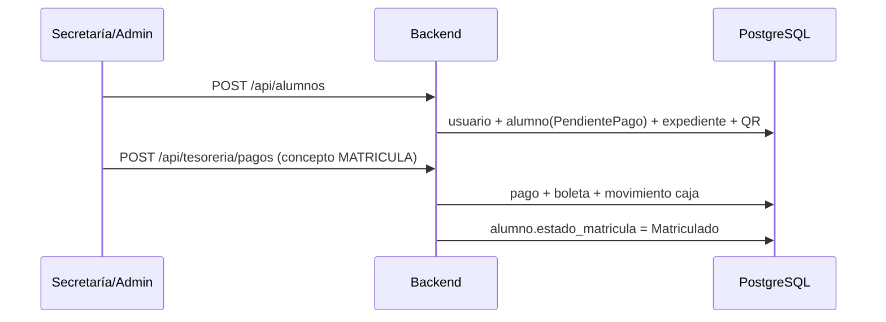
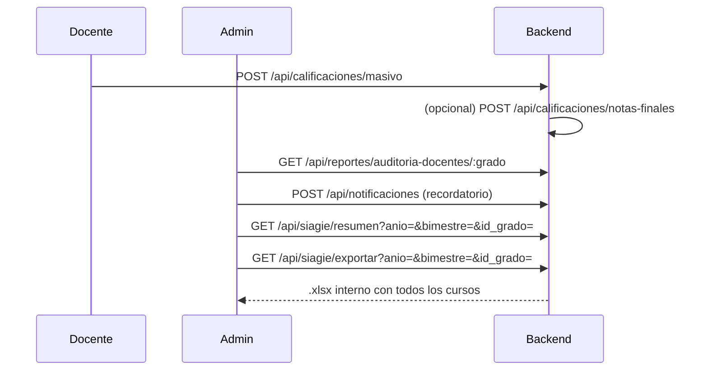
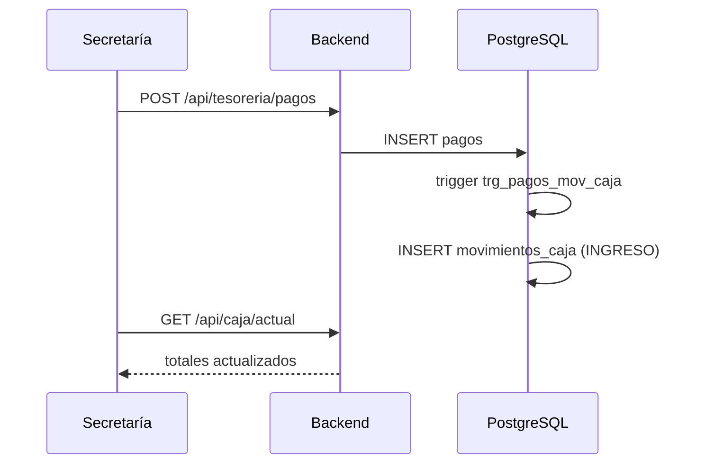
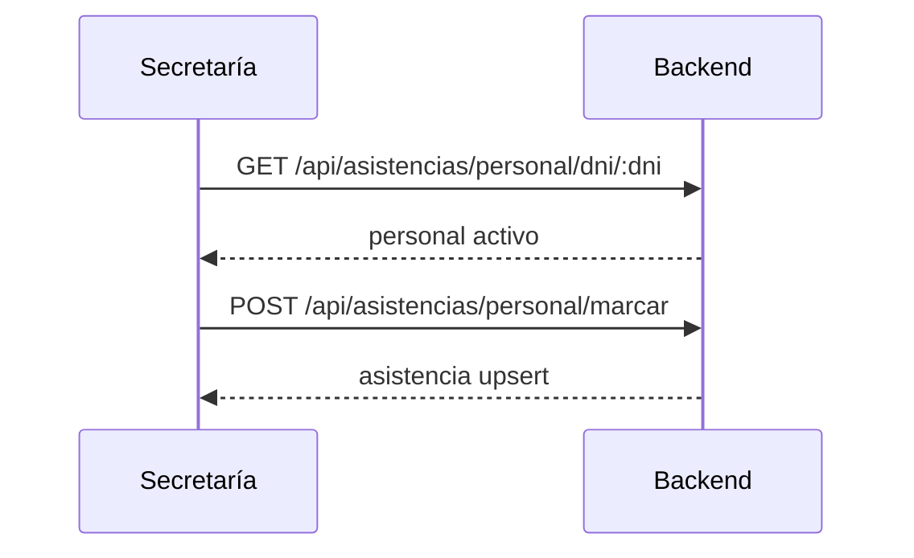

# 07 — Flujos por Rol (de inicio a fin)

Este documento describe el recorrido real del usuario en la interfaz, las llamadas HTTP que
dispara y los efectos en base de datos. Complementa `08-PROCESOS-DE-NEGOCIO.md` (visión por
proceso) y `05-API-REST.md` (contrato técnico).

---

## 0. Flujo común de sesión

### 0.1 Arranque

| Paso | Usuario | Sistema |
|---|---|---|
| 1 | Abre `http://localhost:4200` | Angular redirige a `/login` |
| 2 | Ingresa DNI y contraseña | Validación local: DNI 8 dígitos, contraseña ≥6 |
| 3 | Clic “Ingresar” | `POST /api/auth/login` |
| 4 | — | Backend busca por DNI, verifica estado `ACTIVO`, compara bcrypt, actualiza `ultimo_login`, firma JWT |
| 5 | — | Frontend guarda `siga_uc_token` y `siga_uc_user` en `localStorage` |
| 6 | — | Si `requiere_cambio_password = true` → `/cambiar-password`; si no, redirección por rol: `/admin`, `/secretaria`, `/docente`, `/estudiante` |
| 7 | Ve layout con header + sidebar | Header carga contador de no leídas y arranca polling cada 30 s |

### 0.2 Navegación protegida

```text
Ruta solicitada
  → authGuard: ¿token existe y no expiró?  ──no──> /login?returnUrl=...
              ¿requiere cambio de contraseña? ──sí──> /cambiar-password
  → roleGuard: ¿rol autorizado?            ──no──> dashboard de su rol
  → carga lazy del componente
```

### 0.2.1 Cambio obligatorio de contraseña

1. El login devuelve `requiere_cambio_password`.
2. Si es `TRUE`, el frontend redirige a `/cambiar-password` y `authGuard`/`roleGuard` bloquean
   los módulos.
3. La API también bloquea: cualquier endpoint autenticado fuera de la allowlist responde `403`
   con `errors.codigo = "CAMBIO_PASSWORD_REQUERIDO"`.
4. El usuario envía `password_actual`, `password_nueva` (≥6) y `confirmar_password` a
   `PUT /api/auth/cambiar-password`.
5. El backend verifica la actual con bcrypt, actualiza el hash con `crypt` y pone
   `requiere_cambio_password = FALSE`.
6. El frontend actualiza `localStorage`, marca el flag como `false` y redirige al dashboard.

### 0.3 Header (todos los roles)

| Acción | Llamada | Efecto |
|---|---|---|
| Campanita | `GET /api/notificaciones/no-leidas` cada 30 s | Actualiza badge |
| Abrir buzón | `GET /api/notificaciones` | Lista en modal |
| Ver detalle | `PUT /api/notificaciones/:id/leer` | Marca leída y descuenta contador |
| Marcar todas | `PUT /api/notificaciones/leer-todas` | Contador a 0 |
| Carné QR | `GET /api/auth/perfil` | Obtiene `credencial_qr.codigo_qr`, genera QR con `qrcode` y permite imprimir |
| Cerrar sesión | — | Borra `localStorage`, redirige a `/login` |

### 0.4 Logout

- `POST /api/auth/logout` existe, pero el frontend **no lo llama**.
- El logout real es local: elimina token y usuario.
- El token sigue técnicamente válido hasta su expiración si fue copiado.

---

## 1. ADMIN

**Ruta base:** `/admin` · **Menú:** 10 módulos + header.

### 1.1 Dashboard ejecutivo (`/admin`)

1. Al entrar, `DashboardComponent` llama `GET /api/reportes/dashboard`.
2. Muestra KPIs: **Estudiantes matriculados**, **Plana Docente** (usuarios DOCENTE
   activos con ficha sin cese), **Personal activo** (todo el personal sin cese),
   **Recaudación Anual**, pre-tickets pendientes, monto pendiente, retirados, grados y
   cursos.
3. El panel **Cobranza y expedientes** muestra pre-tickets por cobrar y retirados; no
   promete alertas de asistencia.
4. No hay gráficos; son tarjetas numéricas.
5. Si falla, muestra estado de error y permite recargar.

### 1.2 Padrón de alumnos (`/admin/alumnos`)

#### Listado
1. `GET /api/alumnos?anio=2026` (opcional `id_grado`, `estado_matricula`, `search`).
2. Selector de año (6.4): por defecto el año activo; el catálogo viene de
   `GET /api/anios-lectivos` (ADMIN/SECRETARIA).
3. Tabla con DNI, nombre, grado, estado, apoderado y acciones.
4. Filtros: grado, estado, texto; botón limpiar.

#### Modo histórico (6.4)
Si el año elegido no es el activo, la pantalla muestra el badge **Histórico** y un aviso de
solo lectura: se ocultan **Nueva matrícula**, editar, retirar y restablecer contraseña.
El listado, la ficha y la búsqueda siguen disponibles. Los grados del filtro se cargan del
año elegido (no hay IDs fijos 1–5).

#### Ver ficha
1. Clic en “Ver”.
2. Abre modal con datos del alumno y apoderado.
3. No hay llamada adicional: usa el registro ya cargado.

#### Nueva matrícula
1. Clic “Nueva matrícula”.
2. Formulario: DNI (8), nombres, apellidos, fecha de nacimiento, grado, condición, colegio
   de procedencia y datos del apoderado.
3. **El correo del apoderado es obligatorio** en la UI.
4. `POST /api/alumnos` con el payload.
5. Backend (transacción):
   - Crea apoderado si hay nombres.
   - Genera correo institucional `nombre.apellido@unioncientifica.edu.pe`.
   - Usa correo personal del alumno o, si no, el del apoderado.
   - Crea usuario ESTUDIANTE con contraseña `UC<DNI>`.
   - Genera código `EST-XXX` (máximo actual + 1).
   - Crea alumno en estado `PendientePago`.
   - Crea expediente y credencial QR.
6. Alerta con código, contraseña temporal, correo y recordatorio de pasar por Tesorería.
7. Recarga el listado.

#### Editar ficha
1. Clic “Editar”.
2. Cambia nombres, apellidos, fecha, grado, condición, colegio.
3. `PUT /api/alumnos/:id` → `UPDATE alumnos` con `COALESCE`.
4. No actualiza el usuario asociado (nombres/correo del login no cambian).

#### Retirar
1. Clic “Retirar”.
2. Modal con motivo (obligatorio), fecha (hoy por defecto) y colegio destino.
3. `PUT /api/alumnos/:id/retirar`.
4. Backend valida que no esté ya retirado; actualiza estado, fecha, motivo, destino y
   resolución.
5. **No** congela el expediente ni desactiva el usuario, aunque el mensaje diga “expediente
   congelado”.

#### Reset de contraseña
1. Clic “Reset”.
2. Confirmación.
3. `PUT /api/auth/reset-password` con `{ dni }` (endpoint de auth, no de alumnos).
4. Backend pone `UC<DNI>`, marca `requiere_cambio_password = TRUE`.
5. UI muestra la contraseña temporal.

### 1.3 Personal y usuarios (`/admin/personal`)

#### Listado
1. `GET /api/personal` con filtros `id_rol`, `estado`, `search`.
2. Muestra nombre, DNI, rol, especialidad, cargo, estado, último login y acciones.

#### Nuevo personal
1. Formulario: DNI, nombres, apellidos, correo institucional (opcional), **correo personal
   obligatorio**, teléfono, rol, especialidad, cargo, contraseña (default `UC2026*`).
2. `POST /api/personal`.
3. Transacción: usuario + personal + credencial QR.
4. Tipo de QR según rol: ADMIN, SECRETARIA o DOCENTE.
5. Alerta con correo y contraseña temporal.

#### Editar
1. `PUT /api/personal/:id`.
2. Actualiza usuario (nombres, correos, teléfono, rol) y personal (especialidad, cargo).
3. Cambiar rol no recrea la credencial QR.

#### Cesar
1. Modal con motivo (obligatorio), fecha y **observaciones** (opcional, hasta 1000
   caracteres).
2. `PUT /api/personal/:id/cesar`.
3. Actualiza `personal.fecha_cese`, `motivo_cese`, `personal.observaciones` y
   `usuarios.estado = 'CESADO'`.
4. El usuario ya no puede iniciar sesión.
5. La observación se muestra en la ficha (modal de edición) del trabajador cesado.

#### Reactivar
1. `PUT /api/personal/:id/reactivar`.
2. `usuarios.estado = 'ACTIVO'` y limpia fecha, motivo y observación del cese.

#### Reset de contraseña
1. `PUT /api/personal/:id/reset-password`.
2. Backend usa DNI del personal → `UC<DNI>`, marca cambio requerido.

#### Carné QR
1. Clic “Carné”.
2. Muestra QR con `codigo_qr` del usuario (no hay endpoint específico; usa el registro del
   listado o el perfil).

### 1.4 Carga curricular (`/admin/carga-curricular`)

1. Carga grados (`GET /api/grados`), cursos (`GET /api/cursos`) y docentes activos
   (`GET /api/personal?id_rol=2&estado=ACTIVO`).
2. Selecciona un grado (por defecto 2.º).
3. `GET /api/carga-curricular/grado/:id` + `GET /api/carga-curricular/grado/:id/tutor`.
4. Tabla de cursos con docente, área y horas.
5. **Asignar/editar:** modal con curso, docente y horas.
   - Crear: `POST /api/carga-curricular` (UNIQUE grado+curso+año).
   - Editar: `PUT /api/carga-curricular/:id` (docente/horas).
   - Si el curso ya está asignado, la UI explica el error de llave duplicada.
6. **Eliminar:** `DELETE /api/carga-curricular/:id`.
7. **Tutor:** modal con docente; `POST /api/carga-curricular/tutor` reemplaza el anterior.

> No hay CRUD de horarios ni de competencias; se alimentan por seed/BD.

### 1.5 Asistencia QR (`/admin/asistencia-qr`)

1. Fecha por defecto: hoy.
2. `GET /api/asistencias/personal/todos?fecha=...` → personal activo con marcación del día.
3. `GET /api/asistencias/personal/resumen?fecha=...` → KPIs Puntual/Tardanza/Falta.
4. “Escanear” es un input de DNI (no usa cámara):
   - `GET /api/asistencias/personal/dni/:dni`.
   - Backend valida que exista y esté ACTIVO.
5. Elige estado `Puntual`, `Tardanza` o `Falta`.
6. `POST /api/asistencias/personal/marcar` con hora actual.
7. Upsert por (`id_personal`, `fecha`): si ya marcó, actualiza.
8. Recarga lista y resumen; muestra último escaneo.

### 1.6 Tesorería (`/admin/tesoreria`)

Es un **wrapper** de `SecretariaTesoreriaComponent`; el flujo es idéntico al de Secretaría
(ver §2.3).

### 1.7 Caja (`/admin/caja`)

Es un **wrapper** de `SecretariaCajaComponent`; el flujo es idéntico al de Secretaría
(ver §2.4).

### 1.8 Exportación interna SIAGIE (`/admin/siagie`)

> **No es una exportación oficial a SIAGIE/MINEDU.** No hay portal, plantilla oficial ni
> carga de archivos. Es un Excel de apoyo interno generado desde las notas de SIGA-UC.

1. Carga el catálogo de años (`GET /api/anios-lectivos`, ADMIN/SECRETARIA) y los grados del
   año elegido (`GET /api/grados?anio=`).
2. El formulario solo pide año, grado y bimestre. Muestra el aviso:
   “Exportación interna. No es una exportación oficial a SIAGIE/MINEDU.”
3. `GET /api/siagie/resumen?anio=&bimestre=&id_grado=` devuelve cursos, alumnos, notas,
   conclusiones y advertencias. Si faltan notas, el resumen lo dice; el Excel se puede
   generar con celdas vacías.
4. `GET /api/reportes/auditoria-docentes/:id_grado?bimestre=&anio=` muestra el estado de
   carga por docente.
5. “Notificar al docente” obtiene `GET /api/personal/:id_personal` y envía
   `POST /api/notificaciones` (campanita + correo en modo prueba).
6. “Exportar Excel interno” llama a `GET /api/siagie/exportar?anio=&bimestre=&id_grado=`.
7. El backend incluye **todos los cursos de la carga curricular** (H05) y los alumnos
   `Matriculado`/`PendientePago`; responde
   `EXPORTACION_INTERNA_<grado>_BIM<n>_<año>.xlsx`, registra `exportaciones_siagie` y
   audita `SIAGIE`/`EXPORTAR`.
8. El navegador descarga el archivo. `422` si no hay cursos o alumnos; `403` para roles
   distintos de ADMIN.

> Requiere que existan `notas_finales_area` para que el archivo traiga notas. Si los
> docentes solo registraron calificaciones por competencia y nadie ejecutó el cálculo de
> nota final, el Excel sale con celdas de nota vacías (sin inventar datos). Ver
> `15-HALLAZGOS`.

### 1.9 Reportes y libretas (`/admin/reportes`)

Tres pestañas:

| Pestaña | Llamada | Resultado |
|---|---|---|
| Libretas | `GET /api/alumnos?id_grado=&anio=<año>` | Lista de alumnos; “Ver libreta” → `GET /api/reportes/libreta/:id?bimestre=&anio=` |
| Cuadro de mérito | `GET /api/reportes/cuadro-merito/:id_grado?bimestre=&anio=` | Top 10, medallas, promedio ponderado |
| Alumnos en riesgo | `GET /api/reportes/alumnos-riesgo/:id_grado?bimestre=&anio=` | Alumnos con ≥2 cursos en C y tutor |

Selector de año (6.4): por defecto el activo; los años no activos muestran el badge
**Histórico**. Las libretas y el PDF usan el año elegido. Los deep links
`/admin/reportes?anio=&dni=&grado=&bimestre=` preseleccionan grado/año y abren la libreta
del DNI.

La libreta muestra alumno, tutor, notas por curso, conclusión y asistencia; se imprime con el
navegador (no genera PDF).

### 1.10 Auditoría y actas (`/admin/auditoria`)

1. `GET /api/auditoria` con filtros módulo/acción/búsqueda (máx. 200).
2. `GET /api/auditoria/modulos`, `GET /api/auditoria/estadisticas`.
3. Detalle de registro: `GET` local (usa el objeto de la lista) y muestra JSONB anterior/nuevo.
4. Pestaña Actas: `GET /api/auditoria/actas`.
5. “Cerrar acta”: confirmación → `POST /api/auditoria/actas/cerrar`.
6. Backend actualiza estado, fecha, usuario y hash MD5.
7. **No bloquea** nuevas modificaciones de notas; el mensaje de la UI es aspiracional.

### 1.11 Notificaciones

- ADMIN y SECRETARIA pueden enviar a un usuario desde SIAGIE o desde la campanita (el
  módulo de envío no tiene pantalla propia; el header solo lee).
- DOCENTE **no** puede enviar notificaciones individuales: `POST /api/notificaciones`
  responde 403 (H62). `POST /masivo` sigue siendo solo ADMIN.
- Envío masivo existe en API, pero **no tiene UI**.

### 1.12 Histórico por estudiante (`/admin/historico`, 6.4)

1. Input de DNI (8 dígitos) y `GET /api/reportes/consolidado/:dni` (ADMIN/SECRETARIA).
2. La identidad se agrupa por `id_usuario`/DNI, no por `id_alumno` anual.
3. Muestra una fila por año con grado/sección, estado de matrícula, resultado de promoción,
   notas AD/A/B/C, % de asistencia, total pagado, deuda pendiente y pensiones pagadas/total.
4. Totales por persona: años, pagado, deuda, notas y pensiones (suma de las filas anuales).
5. Acciones por año:
   - **Libreta**: `/admin/reportes?anio=&dni=&grado=&bimestre=4` (abre el modal).
   - **Asistencia**: modal con `GET /api/asistencias/alumno/:id_alumno?anio=`.
   - **Tesorería**: `/admin/tesoreria?anio=&dni=` (filtra el padrón de ese año).
6. Los años no activos aparecen con etiqueta **Histórico**; la pantalla es solo lectura.

---

## 2. SECRETARIA

**Ruta base:** `/secretaria` · **Menú:** 5 módulos.

### 2.1 Dashboard financiero (`/secretaria`)

1. `GET /api/tesoreria/estadisticas?anio=<actual>&mes=<actual>`.
2. `GET /api/tesoreria/pre-tickets?estado=PENDIENTE`.
3. Muestra recaudado del mes, cantidad de pagos, pendientes y monto por cobrar.
4. El botón “Cobrar” de un pre-ticket muestra “próximamente” (no navega).

### 2.2 Padrón de alumnos (`/secretaria/padron`)

Wrapper de `AdminAlumnosComponent`. Puede listar, matricular, editar, retirar y resetear
contraseña, igual que Admin. Incluye el selector de año (6.4); si elige un año no activo, la
pantalla pasa a **solo lectura** y oculta las escrituras.

### 2.3 Tesorería y pensiones (`/secretaria/tesoreria`)

1. `GET /api/alumnos?anio=<año>`; el selector de año (6.4) usa el catálogo de
   `GET /api/anios-lectivos` (SECRETARIA puede leerlo).
2. Para **cada alumno**, `GET /api/tesoreria/pensiones/alumno/:id?anio=<año>` (N+1
   peticiones en paralelo). Calcula estado general:
   - Sin pensiones → “Sin datos”.
   - 0 pendientes → “Al Día”.
   - ≥3 pendientes → “Moroso”.
   - Otros → “Con Deuda”.
3. `GET /api/tesoreria/pre-tickets?estado=PENDIENTE&anio=<año>`.
4. Tabla con meses Ene–Dic, estado por mes y acciones.
5. Si el año no es el activo, la pantalla muestra el badge **Histórico** y oculta
   **Cobrar** y **Generar pensiones**; el padrón, los meses y los pre-tickets quedan en
   solo lectura.
6. **Cobrar pensión/matrícula:**
   - Abre modal con concepto, monto (250 por defecto), forma de pago y número de operación
     (obligatorio).
   - Mapea concepto a ID **hardcodeado**:
     `Matrícula Escolar 2026 → 1`, `Pensión Octubre → 9`, `Noviembre → 10`, `Diciembre → 11`.
   - Busca `id_pension` del mes en la lista del alumno.
   - `POST /api/tesoreria/pagos`.
7. Backend crea pago + boleta, actualiza pensión/pre-ticket, y si es matrícula pasa al alumno
   a `Matriculado`.
8. Alerta con número de boleta y recarga todo.

**Limitaciones visibles:**
- Solo ofrece Oct/Nov/Dic en el modal de cobro (aunque el backend soporta cualquier mes).
- No hay UI para crear pre-tickets, generar pensiones, aplicar becas ni ver estadísticas
  detalladas.
- El mapeo de conceptos está en el frontend y puede romperse si cambian IDs.

### 2.4 Cuadre de caja (`/secretaria/caja`)

1. `GET /api/caja/actual`.
2. Si hay caja abierta, `GET /api/caja/movimientos/:id_apertura`; muestra movimientos y
   totales.
3. **Aperturar:** modal con monto inicial (100 por defecto) y observaciones →
   `POST /api/caja/aperturar`.
   - Si ya hay caja abierta, backend responde 409.
   - Crea movimiento `APERTURA`.
4. **Egreso:** modal con concepto, monto y comprobante →
   `POST /api/caja/egresos`.
5. **Cerrar:** modal con efectivo físico (precargado con el esperado) →
   `POST /api/caja/cerrar`.
   - Backend calcula y devuelve cierre.
   - UI muestra reporte y confirma.
6. Totales en pantalla: esperado = inicial + ingresos − egresos; total general = inicial +
   ingresos; diferencia = físico − esperado.

### 2.5 Asistencia QR (`/secretaria/asistencia-qr`)

Wrapper de `AdminAsistenciaQrComponent`; mismo flujo que §1.5.

---

## 3. DOCENTE

**Ruta base:** `/docente` · **Menú:** 5 módulos.

### 3.1 Mis cursos (`/docente`)

1. Obtiene `info_adicional.id_personal` del usuario logueado.
2. `GET /api/carga-curricular/docente/:id_personal` (año 2026 por defecto).
3. Agrupa cursos por área académica y muestra grado/sección/horas.
4. Los botones “Ir a asistencia/notas” muestran un aviso “próximamente”; la navegación real
   se hace por el sidebar.

### 3.2 Registro de notas (`/docente/notas`)

1. `GET /api/carga-curricular/docente/:id_personal`.
2. Selecciona el primer curso automáticamente.
3. `GET /api/calificaciones/curso/:id_curso/grado/:id_grado?bimestre=2`.
4. Renderiza matriz: filas = alumnos matriculados; columnas = competencias; celdas
   `AD/A/B/C`.
5. El docente cambia celdas; se guardan en un cache local
   (`id_alumno-id_competencia`).
6. “Guardar”:
   - Construye `registros[]` con `id_alumno`, `id_curso`, `id_competencia`, `id_personal`,
     `id_grado`, `bimestre`, `anio_lectivo=2026`, `calificacion`.
   - `POST /api/calificaciones/masivo`.
   - Backend hace upsert por alumno/curso/competencia/bimestre/año.
   - Trigger audita cada fila.
7. Mensaje con cantidad insertada y recarga.

**Limitaciones:**
- El bimestre por defecto es 2.
- No hay botón para calcular nota final.
- No se editan conclusiones descriptivas.
- El guardado masivo devuelve `{ insertados, errores[] }`; la UI solo muestra insertados.

### 3.3 Control de asistencia (`/docente/asistencia`)

1. Cursos del docente.
2. Fecha por defecto: hoy.
3. `GET /api/asistencias/curso/:id_curso/fecha/:fecha?id_grado=`.
4. Lista de alumnos `Matriculado` con estado guardado (o vacío).
5. Botones P/T/F por alumno; “Todos presentes”.
6. “Guardar”:
   - Calcula nombre del día con `Date`.
   - `POST /api/asistencias/masivo`.
   - Upsert por alumno/curso/fecha.
7. Muestra insertados y recarga.

### 3.4 Ficha del estudiante (`/docente/ficha-estudiante`)

1. Input de DNI (8 dígitos).
2. `GET /api/alumnos/dni/:dni`.
3. En paralelo:
   - `GET /api/asistencias/alumno/:id_alumno` (historial completo).
   - `GET /api/calificaciones/notas-finales/alumno/:id_alumno` (notas finales agrupadas).
   - `GET /api/asistencias/alumno/:id_alumno/resumen` (estadísticas).
4. Muestra perfil, KPIs de asistencia, notas por curso/bimestre y últimas asistencias.

### 3.5 Reportes de aula (`/docente/reportes`)

1. Cursos del docente.
2. `GET /api/calificaciones/curso/:id_curso/grado/:id_grado?bimestre=`.
3. Calcula en el navegador estadísticas por competencia: conteo y % de AD/A/B/C,
   predominante.
4. Header permite abrir buzón de notificaciones (mismo flujo común).
5. No exporta PDF/Excel.

### 3.6 Notificaciones

- Puede recibir recordatorios de SIAGIE.
- Puede enviar a un usuario vía API (`POST /api/notificaciones`), pero no hay pantalla de
  redacción en su panel.

---

## 4. SECRETARIA — resumen de diferencias con Admin

| Módulo | Admin | Secretaría |
|---|---|---|
| Dashboard | KPIs ejecutivos | KPIs financieros |
| Padrón | Directo | Wrapper |
| Personal | CRUD | Sin acceso |
| Carga curricular | CRUD | Sin acceso |
| QR personal | Directo | Wrapper |
| Tesorería | Wrapper | Componente original |
| Caja | Wrapper | Componente original |
| SIAGIE | Sí | No |
| Reportes académicos | Sí | No |
| Auditoría | Lectura + cierre | Solo lectura (API) |
| Notificaciones | Envío | Solo propias |

---

## 5. ESTUDIANTE

**Ruta base:** `/estudiante` · **Menú:** 3 módulos.

### 5.1 Mis cursos y notas (`/estudiante`)

1. Obtiene `info_adicional.id_alumno` del login.
2. `GET /api/calificaciones/notas-finales/alumno/:id_alumno`.
3. Agrupa por curso y muestra bimestres 1–4 y conclusión.
4. Calcula promedio general en el cliente:
   `AD=4, A=3, B=2, C=1`.
   - ≥3.5 → AD
   - ≥2.5 → A
   - ≥1.5 → B
   - resto → C
5. Si no hay notas finales, muestra vacío (no calcula desde competencias).

### 5.2 Mi asistencia (`/estudiante/asistencia`)

1. `GET /api/asistencias/alumno/:id_alumno/resumen`.
2. Muestra estadísticas globales y resumen por curso.
3. Selecciona el primer curso.
4. `GET /api/asistencias/alumno/:id_alumno?id_curso=:id`.
5. Muestra historial con P/T/F, observación y docente que registró.

### 5.3 Horario (`/estudiante/horario`)

1. `GET /api/horarios/mi-horario`; el backend deriva el grado del token, no de la URL.
2. Solo recibe bloques `PUBLICADO`; si el grado no está publicado, muestra el aviso.
3. La grilla usa los períodos del año (incluye recreo y almuerzo).
4. No acepta IDs de grado ni de otro alumno.

### 5.4 Carné y contraseña

- Carné QR desde el header (mismo flujo común).
- Recuperación de contraseña desde el login.
- No puede cambiar contraseña desde su panel (no hay pantalla de perfil).

---

## 6. Flujos transversales entre roles

### 6.1 Matrícula → pago → alumno activo



### 6.2 Notas → reportes → SIAGIE



### 6.3 Pago → caja



### 6.4 Asistencia QR



---

## 7. Puntos de quiebre del recorrido

| Punto | Riesgo |
|---|---|
| Login | Si `requiere_cambio_password=true`, redirige a `/cambiar-password` y la API bloquea los módulos |
| Matrícula | El alumno queda `PendientePago`; si nadie cobra, no aparece en asistencia/notas |
| Edición de alumno | Sincroniza nombres/apellidos con `usuarios`; el correo personal también se actualiza |
| Retiro | Desactiva el usuario (`INACTIVO`) y congela el expediente en la misma transacción |
| Notas | Sin cálculo automático de nota final, reportes y SIAGIE quedan vacíos |
| SIAGIE | Exportación interna, no oficial; incluye todos los cursos del grado. Sin notas finales, las celdas salen vacías |
| Tesorería | IDs de conceptos y meses hardcodeados en el frontend |
| Caja | Pagos sin caja abierta se imputan a la última apertura (aunque esté cerrada) |
| Reportes | `resumen-asistencia` ignora el año en la consulta |
| Auditoría | Solo las calificaciones se auditan automáticamente |
