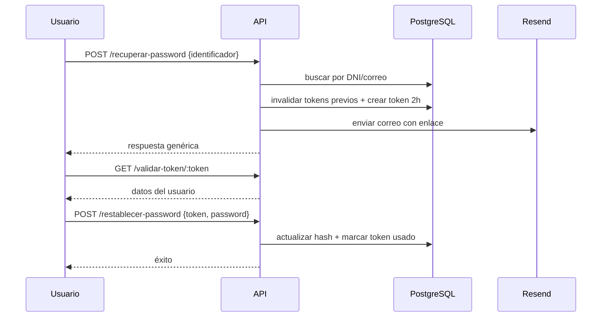

# 11 — Seguridad, Auditoría e Integridad

Este documento describe lo que el sistema **hace hoy** y lo que **no hace**, con evidencia en
código. No es una auditoría formal; es un mapa para priorizar mejoras.

---

## 1. Autenticación

| Control | Implementación | Evaluación |
|---|---|---|
| Identificación | DNI de 8 dígitos | Correcta para el dominio |
| Contraseña | bcrypt coste 10 (`pgcrypto`/`bcrypt`) | Adecuada para el contexto |
| Token | JWT firmado, 8 h | Correcto, sin refresh token |
| Transporte | HTTP en local; HTTPS en producción (Render) | Depende del despliegue |
| Almacenamiento | `localStorage` | Vulnerable a XSS; no hay cookies HttpOnly |
| Logout | Borra token local | No revoca en servidor |
| Recuperación | Token 64 hex, 2 h, un uso | Correcta, con matices |
| Rate limiting | No existe | **Brecha** |
| Bloqueo por intentos | No existe | **Brecha** |
| MFA | No existe | Fuera de alcance |
| Cambio obligatorio | Flag en BD, sin pantalla | **Brecha** |

### Flujo de recuperación



**Observaciones:**
- El token se guarda en texto plano en BD. Si se filtra la BD, los tokens activos son usables.
- El enlace lleva el token en query string; puede quedar en logs/historial.
- `tieneCorreo:false` solo se devuelve para un usuario existente sin correo; puede filtrar
  existencia en ese caso límite.
- No hay límite de solicitudes por usuario/IP.

---

## 2. Autorización

### 2.1 Lo que sí se valida

- `verificarAutenticacion` en todos los routers de negocio.
- `verificarRol(...)` en escrituras críticas y reportes.
- Notificaciones: el DAO filtra por `id_usuario_destino`.
- Libreta: cualquier autenticado, sin validar que el alumno sea el propio.

### 2.2 Lo que no se valida

| Brecha | Evidencia | Impacto |
|---|---|---|
| GET de alumnos para cualquier autenticado | `alumnoRoutes` solo `router.use(verificarAutenticacion)` | Un estudiante puede listar a todos |
| GET de personal para cualquier autenticado | `personalRoutes` | Expone datos de docentes |
| GET de calificaciones para cualquier autenticado | `calificacionRoutes` | Un alumno puede ver notas ajenas |
| GET de asistencias ajenas | `asistenciaRoutes` | Privacidad |
| GET de pagos/caja para cualquier autenticado | `tesoreriaRoutes`, `cajaRoutes` | Información financiera |
| GET de auditoría para cualquier autenticado | `auditoriaRoutes` | Expone trazabilidad |
| Libreta sin pertenencia | `reporteRoutes` | Un alumno puede ver la libreta de otro |
| Docente puede registrar notas de cualquier curso | `calificacionRoutes` | Integridad académica |
| Docente puede registrar asistencia de cualquier curso | `asistenciaRoutes` | Integridad |
| Secretaría puede consultar personal y auditoría | GET amplios | Menor, pero fuera de segregación |
| Estado del usuario no se revalida | `authMiddleware` solo verifica JWT | Usuario cesado conserva acceso 8 h |

### 2.3 Defensa en profundidad recomendada

1. Añadir un middleware de propiedad por recurso:
   - ESTUDIANTE: `id_alumno` asociado a su `id_usuario`.
   - DOCENTE: `id_personal` con carga en el curso/grado.
   - SECRETARIA: solo módulos financieros/padrón.
2. Revalidar `usuarios.estado` y rol en cada petición (consulta ligera o caché corta).
3. Añadir `verificarRol` a los GET sensibles.
4. Implementar rate limiting en auth y recuperación.
5. Añadir auditoría de login, logout, pagos, matrícula, caja y personal.

---

## 3. Validación de entrada

| Módulo | express-validator | Validación manual |
|---|---|---|
| Login | DNI, password | — |
| Alumnos POST | DNI, nombres, apellidos, fecha, grado | Service + BD |
| Alumnos retiro | motivo | Service |
| Recuperación | identificador | Service |
| Restablecer | token, password | Service |
| Personal | ❌ | Service (DNI 8) |
| Carga | ❌ | Service (campos) |
| Asistencia | ❌ | Service (estado) |
| Calificaciones | ❌ | Service (valores/bimestre) |
| Tesorería | ❌ | Service (campos/mes) |
| Caja | ❌ | Service (montos) |
| Notificaciones | ❌ | Service (campos) |
| SIAGIE | ❌ | Controller + multer |

**Riesgos:**
- Tipos inesperados pueden llegar a SQL (aunque parametrizado, PostgreSQL puede fallar).
- No se limita longitud de textos en varios endpoints.
- No se normaliza DNI/correo (espacios, mayúsculas).
- No se validan fechas futuras/pasadas.

---

## 4. SQL e integridad

### 4.1 Lo bueno

- Todos los DAOs usan parámetros `$1, $2...` (sin concatenar valores).
- Los `WHERE` dinámicos se construyen con arrays de condiciones y contadores.
- Restricciones `CHECK`, `UNIQUE`, `FOREIGN KEY` en BD.
- Transacciones en operaciones multi-tabla.
- Triggers garantizan efectos críticos (pago → caja, nota → auditoría).

### 4.2 Riesgos

| Riesgo | Detalle |
|---|---|
| Concurrencia en códigos | `MAX(codigo)+1` y `MAX(numero)+1` sin lock → colisión |
| Lote parcial | Asistencia/calificaciones commitean aunque algunas filas fallen |
| Duplicación de lógica | Servicio y trigger actualizan lo mismo |
| Errores SQL expuestos | Controllers devuelven `error.message` al cliente |
| Sin soft delete | Borrados en cascada pueden eliminar historial |
| Sin versionado de esquema | No hay migraciones; se restaura el dump |
| Función SQL vs DAO | Dos algoritmos de nota final |
| `getResumenAsistenciaGrado` | Ignora el año |

### 4.3 Recomendaciones

- Usar secuencias o `INSERT ... RETURNING` con bloqueo para códigos.
- Envolver cada fila en savepoint o recolectar errores sin commit parcial.
- Unificar cálculo de nota final en un solo lugar.
- Devolver mensajes genéricos en 500 y registrar el detalle en logs.
- Implementar migraciones (Flyway, Liquibase o scripts numerados).

---

## 5. Auditoría

### 5.1 Qué se audita hoy

| Evento | ¿Auditado? | Cómo |
|---|---|---|
| Crear/modificar calificación | ✅ | Trigger `trg_calificaciones_audit` |
| Login | ❌ | No hay inserción |
| Logout | ❌ | No hay |
| Matrícula | ❌ | No hay |
| Edición/retiro de alumno | ❌ | No hay |
| Personal (alta/cese) | ❌ | No hay |
| Pagos/boletas | ❌ | No hay |
| Caja | ❌ | No hay |
| Notificaciones | ❌ | No hay |
| Cierre de acta | ⚠️ Parcial | Se guarda `cerrado_por` y hash, no bitácora |
| SIAGIE | ⚠️ Parcial | Se registra exportación, no bitácora |

### 5.2 Estructura de la bitácora

```json
{
  "id_bitacora": 8,
  "id_usuario": null,
  "fecha_hora": "2026-10-12T23:25:51",
  "modulo_afectado": "Evaluaciones",
  "accion": "MODIFICAR",
  "descripcion": "Calificación alumno ID 1",
  "valor_anterior": { "calificacion": "A" },
  "valor_nuevo": { "calificacion": "AD" },
  "ip_origen": null
}
```

**Problemas:**
- `id_usuario` suele ser NULL porque el frontend no envía `modificado_por`.
- `ip_origen` nunca se llena.
- Solo hay 200 registros visibles (no hay paginación).
- No hay retención ni archivado.

### 5.3 Recomendaciones

1. Crear un `auditoriaService.registrar(...)` reutilizable.
2. Llamarlo desde login, matrícula, pagos, caja, personal y notificaciones.
3. Enviar `modificado_por` desde el frontend o tomarlo del token en el backend.
4. Capturar IP y user-agent.
5. Añadir paginación y filtros por rango.

---

## 6. Actas y hash de integridad

- `actas_bimestrales` guarda `periodo`, `anio_lectivo`, `id_grado`, `estado`.
- Al cerrar:
  ```sql
  hash_integridad = MD5(CONCAT(periodo, anio_lectivo, NOW(), id_grado))
  ```
- El hash es **MD5**, no una firma digital.
- Incluye `NOW()`, por lo que no es reproducible.
- No se encadena con las notas ni con el contenido del acta.
- No hay verificación posterior del hash.
- El cierre **no impide** modificar notas.

**Recomendación:** usar SHA-256, incluir un snapshot de notas/hash por alumno, almacenar el
algoritmo y permitir verificación; bloquear escrituras si el acta está cerrada.

---

## 7. Correo y datos personales

- Se envían nombres, curso, calificaciones y recordatorios por correo.
- El cuerpo de la notificación se inserta en HTML sin escapar (`plantillaNotificacion`), lo que
  permite inyección de HTML en el correo si un usuario malicioso controla el contenido.
- No hay cifrado en reposo más allá del disco del proveedor.
- Los datos de alumnos incluyen fecha de nacimiento, DNI, apoderado y teléfono.
- El backup `siga_uc_backup.sql` está ignorado por Git, pero puede contener datos reales.

**Recomendaciones:**
- Escapar HTML del cuerpo/asunto.
- Minimizar datos en correos.
- Cifrar backups y restringir acceso.
- Política de retención y eliminación.

---

## 8. Configuración y secretos

| Secreto | Dónde | Riesgo |
|---|---|---|
| `DB_PASSWORD` | `.env` | Ignorado por Git; no rotado |
| `JWT_SECRET` | `.env` | Si se filtra, se pueden firmar tokens |
| `RESEND_API_KEY` | `.env` | Permite enviar correos |
| Credenciales de prueba | `docs/CREDENCIALES.md` | Públicas en repo; rotar en producción |
| `siga_uc_completo.sql` | Repo | Contiene hashes de contraseñas de prueba |

**Buenas prácticas actuales:**
- `.env` en `.gitignore`.
- `env.js` aborta si faltan variables.
- CORS con lista blanca.
- Helmet activo.
- Contraseñas hasheadas.

**Pendientes:**
- Rotar `JWT_SECRET` y contraseñas al desplegar.
- No versionar datos reales.
- Añadir escaneo de dependencias (`npm audit`).
- Añadir CSP explícita si se sirve frontend y API juntos.

---

## 9. Matriz de riesgos (resumen)

| # | Riesgo | Severidad | Probabilidad | Impacto |
|---|---|---|---|---|
| R1 | GET amplios sin pertenencia | Alta | Alta | Privacidad académica/financiera |
| R2 | Token válido tras cese | Alta | Media | Acceso indebido |
| R3 | Sin rate limiting en login | Alta | Media | Fuerza bruta |
| R4 | Nota final no calculada | Alta | Alta | Reportes/SIAGIE vacíos |
| R5 | Acta cerrada no bloquea notas | Alta | Media | Integridad académica |
| R6 | Pagos sin caja abierta | Media | Alta | Caja descuadrada |
| R7 | Concurrencia de códigos/boletas | Media | Baja | Errores/duplicados |
| R8 | Auditoría incompleta | Media | Alta | Sin trazabilidad |
| R9 | Correo HTML sin escapar | Media | Baja | Inyección en correo |
| R10 | Hardcode de año/IDs | Media | Alta | Rompe 2027 |
| R11 | Errores SQL expuestos | Media | Media | Fuga de esquema |
| R12 | Sin tests/CI | Media | Alta | Regresiones |
| R13 | Backup no automatizado | Media | Media | Pérdida de datos |
| R14 | Función SQL vs DAO | Baja | Media | Inconsistencia |
| R15 | QR no validado | Baja | Media | Suplantación de asistencia |

El detalle y las recomendaciones están en `15-HALLAZGOS-RIESGOS-Y-MEJORAS.md`.

---

## 10. Checklist de seguridad antes de producción

- [ ] Cambiar `JWT_SECRET` y contraseñas semilla.
- [ ] Configurar HTTPS y HSTS.
- [ ] Restringir CORS al dominio real.
- [ ] Añadir rate limiting en `/auth/login`, `/auth/recuperar-password` y validación de token.
- [ ] Añadir autorización por pertenencia en GET sensibles.
- [ ] Revalidar estado del usuario en el middleware.
- [ ] Implementar cambio obligatorio de contraseña.
- [ ] Auditar login, pagos, caja y matrícula.
- [ ] Bloquear edición de notas con acta cerrada.
- [ ] Verificar backups y restauración.
- [ ] Revisar permisos de `uploads/`.
- [ ] Ejecutar `npm audit` en backend y frontend.
- [ ] Revisar logs para no exponer stack traces.
